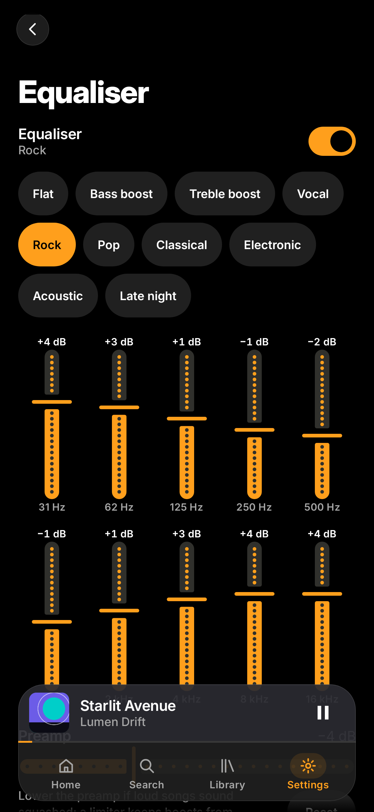
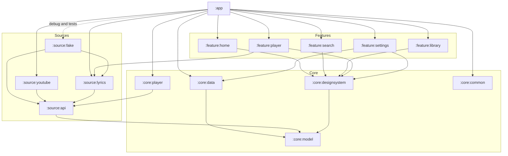

<div align="center">


<h1>Sitara</h1>

<p><strong>Your music, beautifully.</strong></p>

<br>

[](https://github.com/muhib-karim/sitara/actions/workflows/ci.yml)
[](LICENSE)
[](https://kotlinlang.org)
[](https://developer.android.com/compose)
[](https://developer.android.com/media/media3)
[](https://developer.android.com/about/versions/oreo)

**A free, open-source, unofficial YouTube Music client for Android, built around spring physics, glass, artwork colour and lyrics that sing along.**

[Nightly APK](https://github.com/muhib-karim/sitara/actions/workflows/ci.yml?query=branch%3Amain+is%3Asuccess) ·
[Architecture](docs/ARCHITECTURE.md) ·
[Design system](docs/DESIGN.md) ·
[Changelog](CHANGELOG.md)

</div>

---

> [!NOTE]
> Sitara is an early but complete-for-daily-listening preview: **Phase B is done**. Search YouTube Music for songs,
> albums, artists and playlists, or paste or share a YouTube link; play through a background service with a queue you
> can edit, radio and a sleep timer; keep liked songs, playlists and saved albums on the device; see what is trending
> on YouTube Charts; sing along with synced lyrics from LRCLIB; download songs to play offline, with loudness levelling
> and crossfade (`0.6.0`). Phase C brought real covers, a player coloured by the cover and freely scrolled lyrics
> (`0.7.0`), then gapless joins, speed and pitch, skip silence and a sleep timer you can extend (`0.8.0`), and an
> equaliser (`0.9.0`). On `main`: a stage blurred from the cover, hero lyrics and a floating glass dock. Releases are
> on the [Releases](https://github.com/muhib-karim/sitara/releases) page.

## Screenshots

<div align="center">

| Home | Player | Lyrics | Search | Library | Equaliser |
| :---: | :---: | :---: | :---: | :---: | :---: |
|  |  |  |  |  |  |

<sub>Recorded by the Record screenshots workflow (Roborazzi on Robolectric) from hand-built fixtures shaped like a listener's library; release builds contain no sample data. Light versions and more screens live in docs/screenshots.</sub>

</div>

## Why Sitara

Existing clients cover the basics well. Sitara aims for the things that make an app feel *finished*:

- **Motion you can feel.** Transitions ride springs. The cover travels from the unified dock to the player on a shared-element spring. Reduced motion uses instant transitions.
- **Colour from the music.** Now Playing and Lyrics sit on the cover itself, blurred across the screen and washed in its colour, shaded only as far as the text needs to stay at 4.5:1. Its vibrant colour accents the stage, the mini player and the open tab; the rest of the app keeps its saffron (or Material You) accent. AMOLED removes the wash.
- **Lyrics as the hero.** Large, heavy Inter Display lyrics, a crisp white active line, context dimmed and blurred by distance, and tap-to-seek; scroll away to read ahead and one tap brings you back to the current line. Transliteration for Bangla, Hindi and Urdu is planned so everyone can sing along.
- **Playback that outlives the screen.** The queue, auto-advance and sleep timer live in the playback service, so the notification, Bluetooth and Android Auto controls keep working when the app is closed.
- **Sound that flows.** Songs play at a similar volume, and can crossfade into each other while albums stay gapless. A 10-band equaliser shapes them, or hands the sound to your phone's own.
- **Offline when you need it.** Download songs, albums and playlists, on Wi-Fi only unless you allow mobile data.
- **Reliable by design.** Stream sources sit behind an interface with automatic fallback, and only the app and system surfaces may control the media session.
- **Accessible from the start.** TalkBack labels, a reduced-motion mode and contrast-checked artwork palettes are part of the design system.
- **Built in the open.** Tests, screenshot verification and lint run on every push.

Planned, not built yet: *Sitara Sync* (end-to-end encrypted sync through storage you own) and per-song sound profiles.

## Features

| Area | Feature | Status |
| --- | --- | :---: |
| **Shell** | One floating glass pill for the mini player and the four tabs, tinted with the cover's accent; it folds into a single row while you scroll on and unfolds when you scroll back or tap the open tab; edge-to-edge layout | ✅ |
| | Home: YouTube Music's own Home, signed out (Quick picks, playlists, new albums, songs, artists; more shelves as you scroll), filtered by its mood chips, with Listen again, Your likes and Jump back in from your library; placeholders while it loads; offline, a Try again card above the YouTube Charts trending list and your shelves | 🧪 |
| | Search: recent searches (kept on the phone, remove one or clear all), YouTube Music's suggestions while typing (your recent searches when it does not answer), Moods & genres as colour tiles that open each mood's page, and the last filter remembered | 🧪 |
| **Library** | Liked songs, saved albums and artists, recently played (latest 500 plays), stored on the device (Room) | 🧪 |
| | Liked songs and Downloads pinned with their counts; playlists, songs, albums, artists or downloads as a grid of covers or a list (kept); ordered by Recently added or A to Z, and for songs and artists also by Recently played or Most played from your play history; 2 × 2 collages for playlists with four covers | 🧪 |
| | Your own playlists: create, rename, delete, drag to reorder, remove songs; Add to playlist from any song or the player | 🧪 |
| **Offline** | Download a song from its menu, or Download all on an album, a playlist or Liked songs; downloaded songs play with no connection and carry a badge | 🧪 |
| | Downloads in the Library: progress, waiting for Wi-Fi, failed with retry, cancel and delete; downloads finish in the background with a notification | 🧪 |
| | Settings: Download on Wi-Fi only (on by default), storage used, Remove all downloads | 🧪 |
| **Player** | Mini player in the navigation dock with an accent progress line: tap or swipe up to open, sideways to skip | 🧪 |
| | Shared artwork transition, white play disc and custom timeline | 🧪 |
| | Real covers on every screen, fetched sized to fit their slot and cached in memory and on disk; YouTube video thumbnails cropped square; the generated gradient while loading or offline | 🧪 |
| | Now Playing and the mini player coloured from the cover (accent from its vibrant colour, wash from its main one), highlight contrast at least 4.5:1, fading between songs | 🧪 |
| | The cover blurred behind Now Playing and Lyrics (Android 12+; a stretched low-resolution copy on older phones), with a colour wash, an accent glow and a shade worked out per cover so text stays at 4.5:1 | ✅ |
| | Thick scrubber that grows under the finger and stays, still, on a song that cannot play; round glass shuffle, repeat, like and more buttons; Playing / Lyrics / Up next pager | ✅ |
| | Queue: unique entries, shuffle with order restore, repeat off / all / one | ✅ |
| | Play next and Add to queue from any song; reorder and remove in Up next | 🧪 |
| | Sleep timer from a sheet: 15 min to 1 h presets, any number of minutes up to 3 h, or the end of this song; +5 or +15 min while it counts; on a monotonic clock | ✅ |
| | Speed 0.5× to 2× and pitch ±6 semitones, set independently from a compact control in Now Playing, for the session; lyrics keep time at any speed | 🧪 |
| | Background playback service: the whole queue is a Media3 playlist; notification and lock screen show title, artist and cover with previous, next and seek; audio focus, pause when headphones disconnect, headset and Bluetooth buttons; keeps playing when the app is swiped away | 🧪 |
| | The queue, current song and position are saved and come back after the app is closed or killed; a headset play button resumes them | 🧪 |
| **Sound** | Normalise loudness (on by default): gentle levelling toward −14 LUFS, at most +6 dB, peaks kept under −1 dBFS | 🧪 |
| | Gapless: the next song's stream is looked up while the current one plays, so songs join without inserted silence | 🧪 |
| | Crossfade, Off or 1 to 12 s; songs from one album stay gapless | 🧪 |
| | Skip silence (off by default) | 🧪 |
| | Equaliser: 10 bands (31 Hz to 16 kHz, ±12 dB) on faders that fill from 0 dB, preamp, ten presets and your own bands, applied while playing with a limiter against clipping; or the phone's own equaliser where it has one, never both | 🧪 |
| | Volume for this song: −6 to +6 dB, kept with the song | 🧪 |
| **Lyrics** | Synced lyrics from LRCLIB in large heavy type under a compact header (cover, title, artist, Like, More) that follow the song and seek on tap; scrolling by hand pauses following until "Back to current line"; plain lyrics when nothing is synced; "No lyrics found" otherwise; cached on the device | 🧪 |
| | LRC and enhanced LRC parsing (offsets, repeated timestamps, word timing) | ✅ |
| **Settings** | Theme: dynamic, artwork or AMOLED black; light / dark; reduced motion | ✅ |
| **Source** | Live YouTube Music search (songs, albums, artists, playlists) with loading, empty, error and retry states (NewPipeExtractor) | 🧪 |
| | Playback: best audio-only stream (opus or m4a) | 🧪 |
| | Links: paste a YouTube Music, YouTube or youtu.be link into Search, or share it to Sitara, to play that song. Tapping a link opens Sitara once it is allowed under Android's "Open by default" settings | 🧪 |
| | Artist, album and playlist pages with Play all and Shuffle | 🧪 |
| | Radio: Start radio from Up next, and a queue about to run out continues with related songs | 🧪 |
| **Later** | Resolver health checks, local files, import, backup and restore | Not started |
| **Accounts** | Account library sync, scrobbling, widgets, Android Auto, Cast | Phase C |
| | Sitara Sync, LAN remote control, smart offline | Phase C |
| **Premium** | Animated canvas, automix, lyric translation and transliteration, Wear OS remote, TV layout | Phase D |

✅ covered by unit or screenshot tests · 🧪 tested on the JVM, awaiting a real-device check

## How it works

- **Playback.** Search, pages, the chart and radio come from YouTube Music through [NewPipeExtractor](https://github.com/TeamNewPipe/NewPipeExtractor); no account or API key is involved. When a song starts, Sitara resolves its best audio-only stream (opus or m4a) on the fly, so links never go stale in the queue. If YouTube refuses NewPipe's request, Sitara asks two other YouTube clients (visionOS, then iOS) before giving up; a song that still cannot play says so in Now Playing and the mini player, with Try again and Skip. Playback runs in a Media3 service with a media session: notification, lock screen, Bluetooth and headset controls work with the app closed.
- **Links.** Paste a `music.youtube.com`, `youtube.com/watch` or `youtu.be` link into Search, or share one to Sitara from another app; the song plays as soon as it resolves. Only the video id is read from the link.
- **Lyrics.** For the playing song Sitara asks [LRCLIB](https://lrclib.net) by title, artist and length (then a search), first with the title cleaned of video labels and featured artists, then as uploaded; it prefers synced lyrics, and keeps what it finds on the device. Requests carry only the app's name and repository URL.
- **Downloads.** A download stores the song's audio in an app-private cache through Media3's download manager, resolving a fresh stream URL whenever it starts or resumes. The player always looks in that cache first, so a downloaded song plays with no connection. Downloads wait for Wi-Fi unless you turn off "Download on Wi-Fi only".
- **Sound.** Loudness levelling runs inside the audio pipeline and adjusts gain slowly as a song plays. Crossfade hands the end of a song to a second player while the next one starts; the main player keeps the queue, so skipping, editing Up next and restoring after a restart behave as usual. While a song plays, the stream of the song that follows it is looked up ahead, so the player has it ready at the join (and a skip to it starts at once). Speed and pitch are applied by the player for as long as playback runs; skip silence is Media3's silence-skipping step in the same audio chain. The equaliser runs after the leveller in Sitara's own audio step (a filter per band, a song's volume trim with the preamp, then a limiter); with the phone's equaliser chosen, Sitara's bands stay flat and the phone's equaliser gets the player's audio session.

## Known limits

- No sign-in: there is no YouTube account, so no account library, history sync or personal recommendations.
- YouTube may answer with a bot check on some networks (it does on cloud servers, for all three stream clients Sitara tries); search and pages still load, but songs may not play there, and the player says so. Downloads need the same streams.
- YouTube passes on no loudness values through NewPipeExtractor, so levelling measures the sound as it plays rather than knowing a song's loudness in advance; the first seconds of a song can be a little louder or softer.
- Crossfade overlaps by switching to a second player; the hand-over may be audible on some devices.
- Gapless joins rely on the player trimming each format's encoder padding; how YouTube's opus and m4a streams join on real albums has not been checked on a phone yet.
- Speed and pitch reset when playback stops and the service ends; they are not saved.
- Handing the sound to the phone's equaliser relies on that equaliser following Android's audio effect announcements; some vendors' equalisers may not, and it has not been checked on a phone yet. The built-in equaliser's sound has been measured in tests, not yet listened to on a phone.
- A song's volume trim is picked up as the song starts, so its first moment may glide from the previous song's level.
- Covers are cached on the device, and the cache can drop old covers when storage runs low; a downloaded song played offline then shows its generated cover instead.
- An unofficial client can break when YouTube changes; fixes land in `:source:youtube`.

## Architecture

Sitara is a multi-module Gradle project. Features depend on core modules and on the `:source:api` contracts, never on a concrete source, so the stream backend can be swapped or repaired in one place.



More detail, including data flow and the CI pipeline, is in [docs/ARCHITECTURE.md](docs/ARCHITECTURE.md). The motion, colour and type system is documented in [docs/DESIGN.md](docs/DESIGN.md).

**Stack:** Kotlin 2.4 · Jetpack Compose 1.12 + Material 3 · Media3 1.10 (ExoPlayer, MediaSessionService, downloads) · Haze glass blur · DataStore · Room · NewPipeExtractor + OkHttp · JUnit 4/5, Turbine · Roborazzi on Robolectric.

## Install

**From a release (recommended).** Open the latest release on the [Releases](https://github.com/muhib-karim/sitara/releases)
page and download `sitara-vX.Y.Z.apk` and `SHA256SUMS`. Check the file with `sha256sum -c SHA256SUMS`, then open the
APK on your phone and allow installing from that source when Android asks. Releases can be tracked with Obtainium.

**Nightly builds.** Every green CI run on `main` uploads a debug APK as the `sitara-debug-apk` artifact. Open the latest
successful run on the [Actions](https://github.com/muhib-karim/sitara/actions/workflows/ci.yml?query=branch%3Amain+is%3Asuccess)
page (a GitHub login is required to download artifacts). A debug build has the same app id as a release but another
signature, so one must be uninstalled before the other installs, which deletes its library and downloads.

Requires Android 8.0 (API 26) or newer.

## Build from source

You need **JDK 21** and **Gradle 9.8** on your `PATH`, plus the Android SDK (compile SDK 37).

```sh
git clone https://github.com/muhib-karim/sitara.git
cd sitara
gradle assembleDebug
```

The debug APK is written to `app/build/outputs/apk/debug/`.

> [!IMPORTANT]
> No Gradle wrapper JAR is committed; the project relies on CI and a locally installed Gradle. Code style is checked with ktlint in CI. Useful tasks:
>
> | Task | What it does |
> | --- | --- |
> | `gradle test` | All unit tests (JVM modules and both Android variants) |
> | `gradle :app:verifyRoborazziDebug` | Compare screenshots with the committed baselines; fails on any mismatch |
> | `gradle :app:recordRoborazziDebug` | Re-record baselines after an intentional UI change (CI does this with the "Record screenshots" workflow) |

## Roadmap

- **Phase A: foundation** (`v0.1.0`). Design system, navigation, player sheet, service-owned queue, lyrics engine, settings, CI with screenshot verification.
- **Phase B: real source** (complete, `0.2.0` to `0.6.0`). Search and browse, links, radio, the on-device library and playlists, a real Home, background playback that survives restarts, synced lyrics, downloads and offline play, loudness levelling and crossfade. Carried over: health checks, local files, import and backup.
- **Phase C: beat the field** (`0.7.0` onward, [plan](docs/plan/PHASE_C_PLAN.md), [parity table](docs/plan/PARITY.md)). Real artwork and an artwork-coloured player first, then gapless playback, speed and a sleep timer, an equaliser, local audio, portable downloads and backup, more lyric sources, automix, widgets, Android Auto and scrobbling, imports and polish.
- **Phase D: premium touches.** Animated canvas, automix, lyric translation and transliteration, Wear OS remote, TV layout.

Follow progress in the [CHANGELOG](CHANGELOG.md) and on the [issue tracker](https://github.com/muhib-karim/sitara/issues).

## Contributing

Contributions of every size are welcome: bug reports, design feedback, translations and code. Read [CONTRIBUTING.md](CONTRIBUTING.md) to get started and please follow the [Code of Conduct](CODE_OF_CONDUCT.md). Security issues go through [private vulnerability reporting](SECURITY.md), never public issues.

## Disclaimer

Sitara is an unofficial client. It is not affiliated with, endorsed by, or connected to YouTube or Google. All trademarks belong to their respective owners. Sitara does not bundle copyrighted media, does not circumvent DRM and does not offer features that require it. You are responsible for using it in line with the terms that apply to you.

## Licence

Sitara is free software, released under the [GNU General Public License v3.0](LICENSE). You may use, study, share and modify it under the terms of that licence.

<div align="center">
<br>

<br>
<sub>সিতারা · ستارہ · star</sub>
</div>
