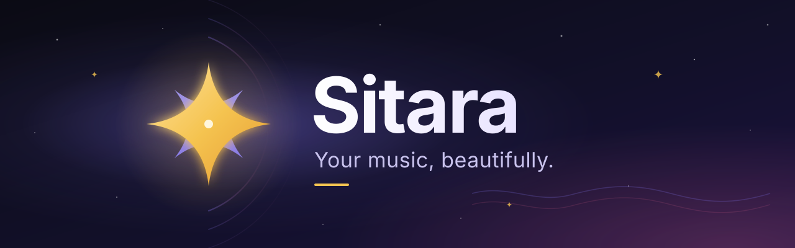
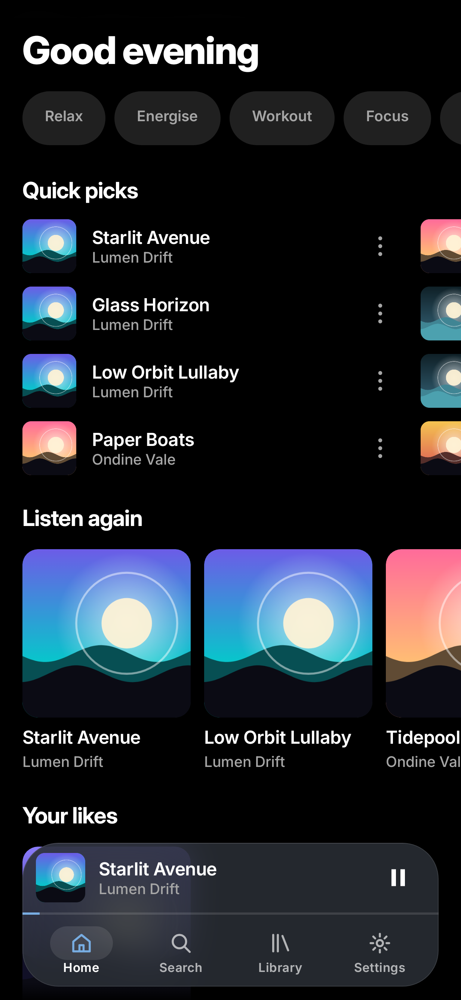
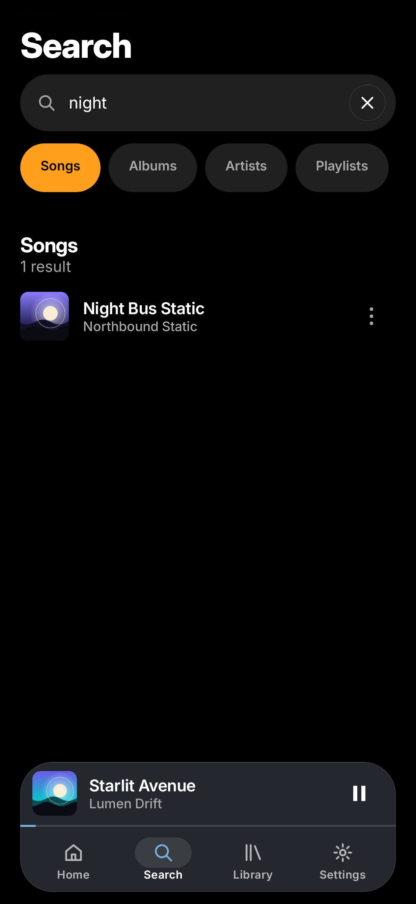
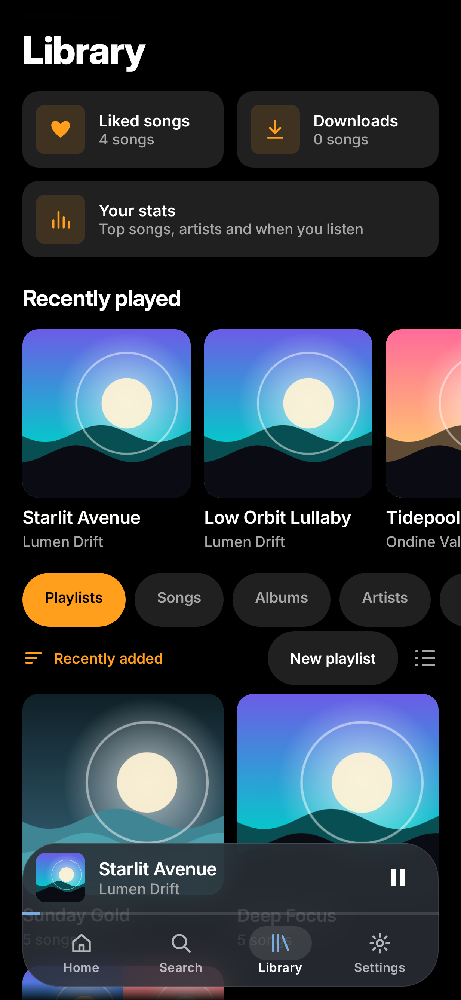
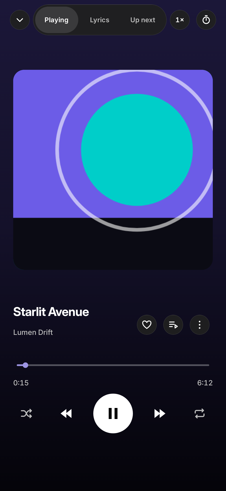
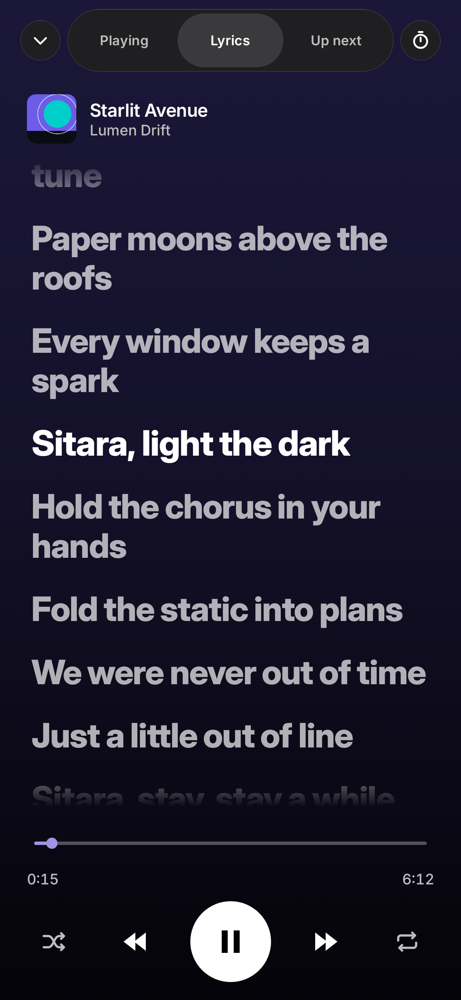
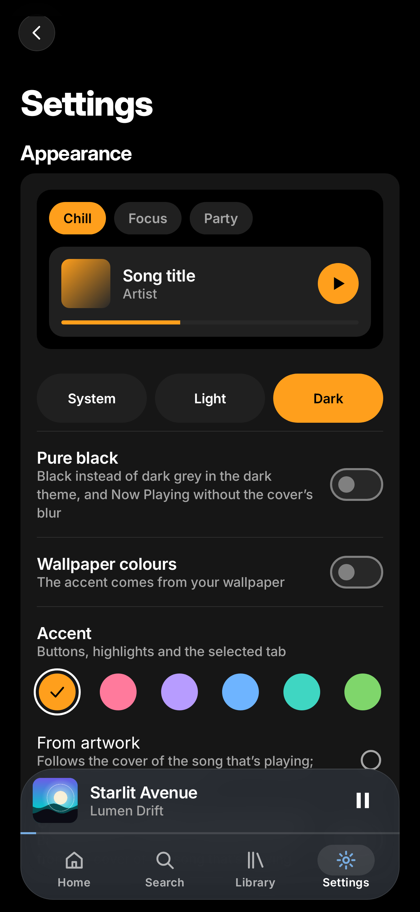
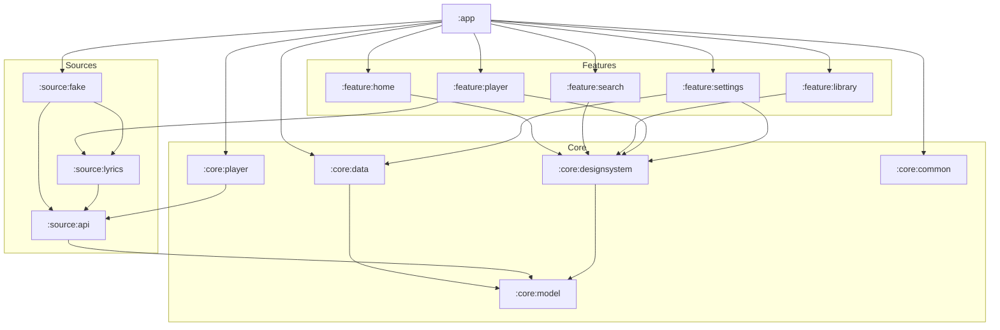

<div align="center">



<br>

[](https://github.com/muhib-karim/sitara/actions/workflows/ci.yml)
[](https://github.com/muhib-karim/sitara/releases)
[](LICENSE)
[](https://kotlinlang.org)
[](https://developer.android.com/compose)
[](https://developer.android.com/media/media3)
[](https://developer.android.com/about/versions/oreo)

**A free, open-source YouTube Music client for Android, built around spring physics, glass, artwork colour and lyrics that sing along.**

[Download](https://github.com/muhib-karim/sitara/releases/latest) ·
[Website](https://muhib-karim.github.io/sitara/) ·
[Architecture](docs/ARCHITECTURE.md) ·
[Design system](docs/DESIGN.md) ·
[Changelog](CHANGELOG.md)

</div>

---

> [!NOTE]
> Sitara is in **Phase A** (`v0.1.0-dev`). The app shell, design system and player run against a built-in sample catalogue; the real streaming source lands in Phase B.

## Screenshots

<div align="center">

| Home | Search | Library |
| :---: | :---: | :---: |
|  |  |  |
| **Player** | **Lyrics** | **Settings** |
|  |  |  |

<sub>Screenshots are recorded by Roborazzi in CI, so they always match the code on `main`.</sub>

</div>

## Why Sitara

Existing clients cover the basics well. Sitara aims for the things that make an app feel *finished*:

- **Motion you can feel.** Every transition rides a spring. The player sheet follows your finger and hands its release velocity to a critically damped spring, so it never snaps or overshoots.
- **Colour from the music.** The now-playing backdrop, accents and controls are tinted from the cover art, with Material You and a pure AMOLED black mode as alternatives.
- **Lyrics as the hero.** Word-by-word karaoke fill, tap-to-seek and, planned, transliteration for Bangla, Hindi and Urdu so everyone can sing along.
- **Reliable by design.** The stream source sits behind an interface with health checks and automatic fallback, and a planned source health dashboard makes it visible.
- **Your data, your storage.** Planned *Sitara Sync* keeps library, likes and settings in step across devices, end-to-end encrypted, through storage you already own. No server of ours.
- **Sound that stays put.** Loudness is matched to a −14 LUFS target, and per-song profiles (volume offset, EQ, trim) are on the roadmap.
- **Accessible from the start.** TalkBack labels, 48 dp targets, 200% font scale and a reduced-motion mode are part of the design system, not an afterthought.
- **Built in the open.** A public test suite, screenshot tests and a reproducible FOSS build pipeline.

## Features

| Area | Feature | Status |
| --- | --- | :---: |
| **Shell** | Floating glass pill tab bar with spring selection, edge-to-edge layout | Phase A ✅ |
| | Home, Search and Library on a sample source with generated gradient covers | Phase A ✅ |
| **Player** | Mini player docked above the tab bar: swipe up to open, down to hide, sideways to skip | Phase A ✅ |
| | Full player sheet on one critically damped spring with drag-velocity hand-off | Phase A ✅ |
| | Artwork-tinted gradient backdrop, scrubber, Up next / Lyrics pager | Phase A ✅ |
| | Queue engine: shuffle with order restore, repeat off / all / one | Phase A ✅ |
| | Sleep timer (minutes or end of track), crossfade curves, LUFS normalisation gain | Phase A ✅ |
| | Demo playback of a royalty-free stream through Media3 | Phase A 🚧 |
| **Lyrics** | LRC and enhanced word-timed LRC parser, word-level karaoke fill | Phase A ✅ |
| **Settings** | Theme: dynamic, artwork or AMOLED black; reduced motion | Phase A ✅ |
| **Source** | Real search and browse, stream resolution per network, health checks and fallback | Phase B |
| | Downloads, local files, synced lyrics, history, playlists, import, backup and restore | Phase B |
| | Gapless, crossfade 0 to 12 s, skip silence, speed and pitch, equaliser | Phase B |
| **Accounts** | Account library sync, scrobbling, widgets, Android Auto, Cast | Phase C |
| | Sitara Sync, LAN remote control, smart offline | Phase C |
| **Premium** | Animated canvas, automix, lyric translation and transliteration, Wear OS remote, TV layout | Phase D |

✅ done · 🚧 in progress

## Architecture

Sitara is a multi-module Gradle project. Features depend on core modules and on the `:source:api` contracts, never on a concrete source, so the stream backend can be swapped or repaired in one place.



More detail, including data flow and the CI pipeline, is in [docs/ARCHITECTURE.md](docs/ARCHITECTURE.md). The motion, colour and type system is documented in [docs/DESIGN.md](docs/DESIGN.md).

**Stack:** Kotlin 2.4 · Jetpack Compose 1.12 + Material 3 · Media3 1.10 (ExoPlayer, MediaSessionService) · Haze glass blur · DataStore · JUnit, Turbine, MockK · Roborazzi on Robolectric.

## Install

**GitHub Releases.** Download the latest APK from [Releases](https://github.com/muhib-karim/sitara/releases/latest). Each release ships a `SHA256SUMS` file so you can verify the download:

```sh
sha256sum -c SHA256SUMS
```

**Obtainium.** Add `https://github.com/muhib-karim/sitara` as a new app to receive updates straight from GitHub Releases.

**Nightly builds.** Every CI run on `main` uploads a debug build as the `sitara-debug-apk` artifact on the [Actions](https://github.com/muhib-karim/sitara/actions/workflows/ci.yml) page.

Requires Android 8.0 (API 26) or newer.

## Build from source

You need **JDK 21** and **Gradle 9.8** on your `PATH`, plus the Android SDK (compile SDK 36).

```sh
git clone https://github.com/muhib-karim/sitara.git
cd sitara
gradle assembleDebug
```

The debug APK is written to `app/build/outputs/apk/debug/`.

> [!IMPORTANT]
> No Gradle wrapper JAR is committed; the project relies on CI and a locally installed Gradle. Code style is checked with ktlint in CI. Useful tasks:
>
> | Task | What it does |
> | --- | --- |
> | `gradle testDebugUnitTest` | Unit tests |
> | `gradle verifyRoborazziDebug` | Compare screenshots with the recorded golden images |
> | `gradle recordRoborazziDebug` | Re-record screenshots after an intentional UI change |

## Roadmap

- **Phase A: foundation** (now). Design system, navigation, player sheet, queue, lyrics engine, settings, green CI and screenshot tests.
- **Phase B: real source.** Search and browse, stream resolution with health checks and fallback, downloads, local files, synced lyrics, playlists, import and backup.
- **Phase C: accounts and connection.** Library sync, scrobbling, widgets, Android Auto, Cast, Sitara Sync, LAN remote control.
- **Phase D: premium touches.** Animated canvas, automix, lyric translation and transliteration, Wear OS remote, TV layout.

Follow progress in the [CHANGELOG](CHANGELOG.md) and on the [issue tracker](https://github.com/muhib-karim/sitara/issues).

## Contributing

Contributions of every size are welcome: bug reports, design feedback, translations and code. Read [CONTRIBUTING.md](CONTRIBUTING.md) to get started and please follow the [Code of Conduct](CODE_OF_CONDUCT.md). Security issues go through [private vulnerability reporting](SECURITY.md), never public issues.

## Disclaimer

Sitara is not affiliated with, endorsed by, or connected to YouTube or Google. All trademarks belong to their respective owners. Sitara does not bundle copyrighted media, does not circumvent DRM and does not offer features that require it. You are responsible for using it in line with the terms that apply to you.

## Licence

Sitara is free software, released under the [GNU General Public License v3.0](LICENSE). You may use, study, share and modify it under the terms of that licence.

<div align="center">
<br>

<br>
<sub>সিতারা · ستارہ · star</sub>
</div>
