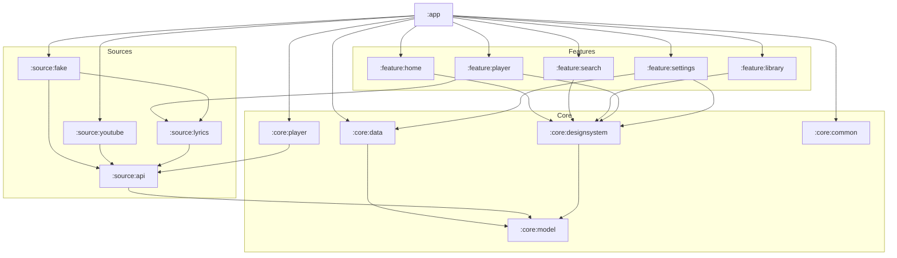

<div align="center">


<h1>Sitara</h1>

<p><strong>Your music, beautifully.</strong></p>

<br>

[](https://github.com/muhib-karim/sitara/actions/workflows/ci.yml)
[](LICENSE)
[](https://kotlinlang.org)
[](https://developer.android.com/compose)
[](https://developer.android.com/media/media3)
[](https://developer.android.com/about/versions/oreo)

**A free, open-source, unofficial YouTube Music client for Android, built around spring physics, glass, artwork colour and lyrics that sing along.**

[Nightly APK](https://github.com/muhib-karim/sitara/actions/workflows/ci.yml?query=branch%3Amain+is%3Asuccess) ·
[Architecture](docs/ARCHITECTURE.md) ·
[Design system](docs/DESIGN.md) ·
[Changelog](CHANGELOG.md)

</div>

---

> [!NOTE]
> Sitara is an early preview, now in **Phase B**. On `main`, **Search finds real songs on YouTube Music and plays them**
> through NewPipeExtractor (not yet in a release). Home, Library and lyrics still use the built-in sample catalogue, and
> the app labels them as samples. Covers are generated gradients for now. `v0.1.0` (sample catalogue only) is on the
> [Releases](https://github.com/muhib-karim/sitara/releases) page.

## Screenshots

<div align="center">

| Home | Library | Player | Lyrics |
| :---: | :---: | :---: | :---: |
|  |  |  |  |

<sub>Captured on an Android emulator by the Device screens workflow on every push to main. Light theme captures live in docs/screenshots.</sub>

</div>

## Why Sitara

Existing clients cover the basics well. Sitara aims for the things that make an app feel *finished*:

- **Motion you can feel.** Transitions ride springs. The cover travels from the unified dock to the player on a shared-element spring. Reduced motion uses instant transitions.
- **Colour from the music.** Artwork colors the listening stage while the chrome keeps its saffron accent. Material You changes only the accent; AMOLED removes the wash.
- **Lyrics as the hero.** Heavy Inter Display lyrics, a crisp active line, distance-softened context and tap-to-seek. Transliteration for Bangla, Hindi and Urdu is planned so everyone can sing along.
- **Playback that outlives the screen.** The queue, auto-advance and sleep timer live in the playback service, so the notification, Bluetooth and Android Auto controls keep working when the app is closed.
- **Reliable by design.** Stream sources sit behind an interface with automatic fallback, and only the app and system surfaces may control the media session.
- **Accessible from the start.** TalkBack labels, a reduced-motion mode and contrast-checked artwork palettes are part of the design system.
- **Built in the open.** Tests, screenshot verification and lint run on every push.

Planned, not built yet: *Sitara Sync* (end-to-end encrypted sync through storage you own), loudness normalisation and crossfade in the audio path, and per-song sound profiles.

## Features

| Area | Feature | Status |
| --- | --- | :---: |
| **Shell** | Unified glass dock with four destinations and edge-to-edge layout | Pending CI |
| | Home and Library on the built-in sample catalogue, labelled as samples, with generated gradient covers | ✅ |
| **Player** | Mini player in the navigation dock: swipe up to open, sideways to skip | Pending CI |
| | Shared artwork transition, white play disc and custom timeline | Pending CI |
| | Artwork backdrop, scrubber, Playing / Lyrics / Up next pager | Pending CI |
| | Queue: unique entries, shuffle with order restore, repeat off / all / one | ✅ |
| | Sleep timer (minutes or end of track) on a monotonic clock | ✅ |
| | Background playback service: the whole queue is a Media3 playlist, system controls skip | 🧪 |
| **Lyrics** | LRC and enhanced LRC parsing, line focus and seek, plain lyrics as static text | Pending CI |
| **Settings** | Theme: dynamic, artwork or AMOLED black; light / dark; reduced motion | ✅ |
| | Loudness normalisation and crossfade (maths tested, not yet in the audio path; shown disabled) | 🚧 |
| **Source** | Live YouTube Music song search with loading, empty, error and retry states (NewPipeExtractor) | 🧪 |
| | Playback of search results: best audio-only stream (opus or m4a), with the sample resolver as fallback | 🧪 |
| | Real home feed and browse, album and artist pages, artwork images, health checks | Phase B |
| | Downloads, local files, synced lyrics, history, playlists, import, backup and restore | Phase B |
| | Gapless, crossfade 0 to 12 s, skip silence, speed and pitch, equaliser | Phase B |
| **Accounts** | Account library sync, scrobbling, widgets, Android Auto, Cast | Phase C |
| | Sitara Sync, LAN remote control, smart offline | Phase C |
| **Premium** | Animated canvas, automix, lyric translation and transliteration, Wear OS remote, TV layout | Phase D |

✅ covered by existing tests · 🧪 awaiting a real-device check · 🚧 partly built · Pending CI = changed in ui1; not built or visually verified yet

## Architecture

Sitara is a multi-module Gradle project. Features depend on core modules and on the `:source:api` contracts, never on a concrete source, so the stream backend can be swapped or repaired in one place.



More detail, including data flow and the CI pipeline, is in [docs/ARCHITECTURE.md](docs/ARCHITECTURE.md). The motion, colour and type system is documented in [docs/DESIGN.md](docs/DESIGN.md).

**Stack:** Kotlin 2.4 · Jetpack Compose 1.12 + Material 3 · Media3 1.10 (ExoPlayer, MediaSessionService) · Haze glass blur · DataStore · NewPipeExtractor + OkHttp · JUnit 4/5, Turbine · Roborazzi on Robolectric.

## Install

**Nightly builds.** Every green CI run on `main` uploads a debug APK as the `sitara-debug-apk` artifact. Open the latest
successful run on the [Actions](https://github.com/muhib-karim/sitara/actions/workflows/ci.yml?query=branch%3Amain+is%3Asuccess)
page (a GitHub login is required to download artifacts).

**Releases.** Signed releases with a `SHA256SUMS` file will be published on [Releases](https://github.com/muhib-karim/sitara/releases)
starting with `v0.1.0`, and can then be tracked with Obtainium.

Requires Android 8.0 (API 26) or newer.

## Build from source

You need **JDK 21** and **Gradle 9.8** on your `PATH`, plus the Android SDK (compile SDK 37).

```sh
git clone https://github.com/muhib-karim/sitara.git
cd sitara
gradle assembleDebug
```

The debug APK is written to `app/build/outputs/apk/debug/`.

> [!IMPORTANT]
> No Gradle wrapper JAR is committed; the project relies on CI and a locally installed Gradle. Code style is checked with ktlint in CI. Useful tasks:
>
> | Task | What it does |
> | --- | --- |
> | `gradle test` | All unit tests (JVM modules and both Android variants) |
> | `gradle :app:verifyRoborazziDebug` | Compare screenshots with the committed baselines; fails on any mismatch |
> | `gradle :app:recordRoborazziDebug` | Re-record baselines after an intentional UI change (CI does this with the "Record screenshots" workflow) |

## Roadmap

- **Phase A: foundation** (`v0.1.0`). Design system, navigation, player sheet, service-owned queue, lyrics engine, settings, CI with screenshot verification.
- **Phase B: real source.** Search and browse, stream resolution with health checks and fallback, downloads, local files, synced lyrics, playlists, import and backup.
- **Phase C: accounts and connection.** Library sync, scrobbling, widgets, Android Auto, Cast, Sitara Sync, LAN remote control.
- **Phase D: premium touches.** Animated canvas, automix, lyric translation and transliteration, Wear OS remote, TV layout.

Follow progress in the [CHANGELOG](CHANGELOG.md) and on the [issue tracker](https://github.com/muhib-karim/sitara/issues).

## Contributing

Contributions of every size are welcome: bug reports, design feedback, translations and code. Read [CONTRIBUTING.md](CONTRIBUTING.md) to get started and please follow the [Code of Conduct](CODE_OF_CONDUCT.md). Security issues go through [private vulnerability reporting](SECURITY.md), never public issues.

## Disclaimer

Sitara is an unofficial client. It is not affiliated with, endorsed by, or connected to YouTube or Google. All trademarks belong to their respective owners. Sitara does not bundle copyrighted media, does not circumvent DRM and does not offer features that require it. You are responsible for using it in line with the terms that apply to you.

## Licence

Sitara is free software, released under the [GNU General Public License v3.0](LICENSE). You may use, study, share and modify it under the terms of that licence.

<div align="center">
<br>

<br>
<sub>সিতারা · ستارہ · star</sub>
</div>
