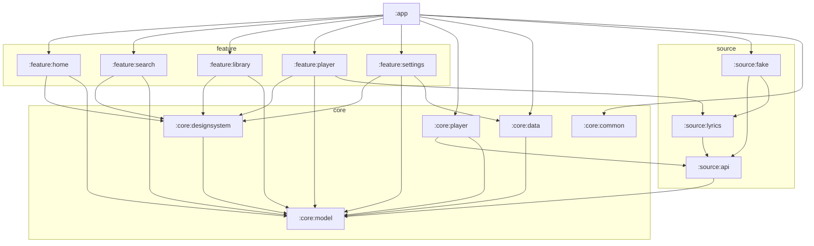
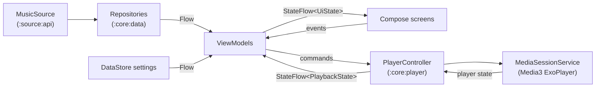
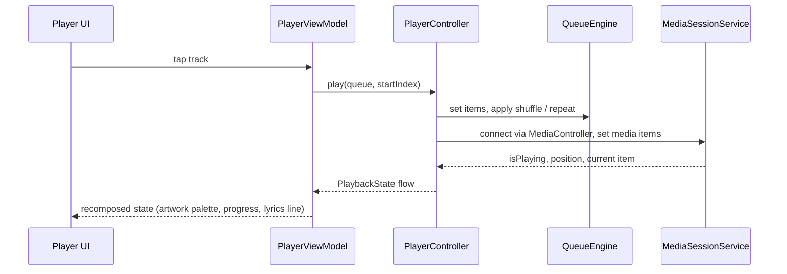
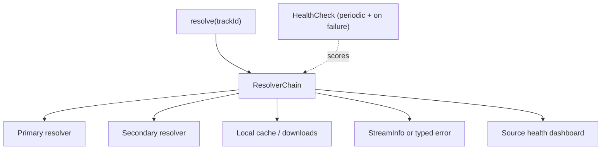
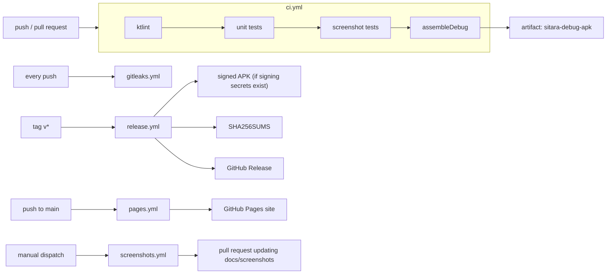

# Sitara architecture

This document describes how Sitara is put together: the module map, how data moves from a music source to the screen, how playback is wired to Media3, how the stream source stays reliable, and how the code is tested and shipped.

> Status: Phase A (`v0.1.0-dev`). Modules marked *planned* do not exist yet.

## Goals

1. **Swap the source, keep the app.** Features talk to interfaces in `:source:api`, never to a concrete backend. A change on the streaming side is a one-module fix.
2. **Pure logic stays pure.** Queue rules, crossfade curves, loudness gain, sleep timer and the LRC parser are plain Kotlin with no Android types, so they are fast to test.
3. **One way to do each thing.** One motion object, one theme, one player controller, one settings store.
4. **Everything visible is tested.** Screens are covered by Roborazzi screenshot tests that also produce the README images.

## Module map

| Module | Kind | Responsibility |
| --- | --- | --- |
| `:app` | Android application | Activity, navigation host, app shell (glass tab bar, mini player dock), dependency wiring |
| `:core:model` | Pure Kotlin | Domain types: `Track`, `Album`, `Artist`, `Playlist`, `Queue`, `LyricsLine`, `LyricsWord` |
| `:core:common` | Pure Kotlin | Result types, coroutine dispatchers, time and formatting helpers |
| `:core:data` | Android library | Repositories over `MusicSource`, DataStore-backed settings |
| `:core:player` | Android library | Media3 `MediaSessionService`, `PlayerController`, queue engine, crossfade curves, LUFS normalisation gain, sleep timer |
| `:core:designsystem` | Android library | Theme, colour roles, artwork palette mapping, `SitaraMotion`, glass surfaces, typography, icons, shared components |
| `:source:api` | Pure Kotlin | Contracts: `MusicSource`, `StreamResolver`, `LyricsProvider`, `HealthCheck` |
| `:source:fake` | Pure Kotlin | Deterministic sample catalogue with generated gradient covers, used by the app in Phase A and by every test |
| `:source:lyrics` | Pure Kotlin | LRC and enhanced (word-timed) LRC parser; lyric providers plug in here |
| `:feature:home` | Android library | Home feed: shelves, quick picks |
| `:feature:search` | Android library | Search field, suggestions, results |
| `:feature:library` | Android library | Playlists, albums, artists, liked songs |
| `:feature:player` | Android library | Mini player, full player sheet, scrubber, Up next / Lyrics pager, karaoke lyrics |
| `:feature:settings` | Android library | Theme mode, reduced motion, playback preferences |
| `:source:youtube` | *planned, Phase B* | Search, browse and stream resolution for the real catalogue |
| `:source:local` | *planned, Phase B* | MediaStore and folder-based local files |

## Dependency graph

Arrows point from a module to the modules it depends on (direct project dependencies only). Feature modules never depend on each other; anything shared moves down into a core module. `:core:common` is a leaf module with no project dependencies.

Rules enforced in review:

- `:core:model`, `:core:common`, `:source:api`, `:source:fake` and `:source:lyrics` stay free of Android dependencies.
- Only `:app` chooses a concrete `MusicSource`. In Phase A that is the fake source; in Phase B it becomes the real source with the fake still available for tests and demo mode.
- UI modules depend on `:core:designsystem` for every colour, shape, spring and duration. Hard-coded values in feature code are a review comment.

## Data flow

Sitara follows unidirectional data flow. State flows down as immutable objects; user intent flows up as events.

1. **Source.** A `MusicSource` exposes suspending calls and flows for home shelves, search, albums, playlists and track metadata, returning `:core:model` types.
2. **Repositories.** `:core:data` wraps sources, adds caching and maps errors into `Result` types from `:core:common`.
3. **ViewModels.** Each screen has a ViewModel that combines repository flows and settings into a single immutable `UiState`, exposed as `StateFlow`.
4. **Compose.** Screens are stateless functions of `UiState` plus an event callback. This is what makes them easy to preview and screenshot-test with fake state.
5. **Settings.** Theme mode, reduced motion and playback preferences live in DataStore and are observed as flows, so changes apply instantly without restarts.

### Playback

- `PlayerController` is the single entry point for playback. It owns a Media3 `MediaController` connected to the `MediaSessionService`, so system media controls, the notification, Bluetooth buttons and lock screen all drive the same session.
- The **queue engine** is pure Kotlin. Shuffle keeps the original order so turning shuffle off restores it exactly; repeat modes are off, all and one.
- **Crossfade** and **normalisation** are computed as pure functions (fade curves; gain from measured LUFS towards a −14 LUFS target) and applied by the player layer. In Phase B they move into a Media3 `AudioProcessor` chain.
- The **sleep timer** supports a duration in minutes or "end of current track".
- Lyrics are parsed once per track into timed lines and words; the UI derives the active line and the karaoke fill fraction from the playback position.

## Stream source abstraction (Phase B)

The most common failure in streaming clients is the upstream service changing. Sitara treats that as a normal operating condition rather than an emergency.

- `StreamResolver` turns a track id into playable stream info. Several resolvers are registered in priority order.
- Each resolver has a `HealthCheck`. Results are cached with a short time-to-live and refreshed after any failure.
- The chain picks the healthiest resolver, falls back on error, and records why. Errors are typed (network, region, parse, unavailable) so the UI can say something useful.
- A **source health dashboard** in settings shows each resolver's state and offers a one-tap diagnostics export for bug reports.
- Network-aware quality selection (Wi-Fi versus mobile) lives in the chain, not in the resolvers.

## Testing strategy

| Layer | Tools | What is covered |
| --- | --- | --- |
| Pure logic | JUnit, Turbine, MockK | Queue engine, shuffle restore, repeat modes, crossfade curves, LUFS gain, sleep timer, LRC and enhanced LRC parsing, palette to theme mapping |
| Flows and ViewModels | Turbine, coroutine test dispatchers | `UiState` emissions for loading, content and error; settings changes |
| Android units | Robolectric | DataStore settings, service wiring that needs a `Context` |
| Screenshots | Roborazzi on Robolectric | Every main screen in dark theme, plus key states; images are written to `docs/screenshots` |

Principles:

- Tests run on the JVM; no emulator is needed for the main suite.
- The fake source is deterministic (stable ids, titles and generated covers), so screenshots are stable across runs.
- A bug fix starts with a failing test.
- Screenshot diffs are reviewed like code. An intentional UI change re-records the golden images in the same pull request.

## CI pipeline

All automation runs on GitHub Actions.

| Workflow | Trigger | Purpose |
| --- | --- | --- |
| `ci.yml` | Push and pull request | ktlint, unit tests, screenshot verification, `assembleDebug`, upload `sitara-debug-apk` |
| `release.yml` | Tags matching `v*` | Builds the release APK, signs it when the signing secrets are configured, writes `SHA256SUMS`, publishes a GitHub Release |
| `pages.yml` | Push to `main` | Publishes `site/` to GitHub Pages, copying in `docs/assets` and `docs/screenshots` |
| `gitleaks.yml` | Push and pull request | Scans for committed secrets |
| `screenshots.yml` | Manual | Re-records Roborazzi screenshots and opens a pull request with the updated `docs/screenshots` |

Signing keys never live in the repository. They are provided only as encrypted GitHub Actions secrets; without them the release workflow still produces an unsigned build and says so.
