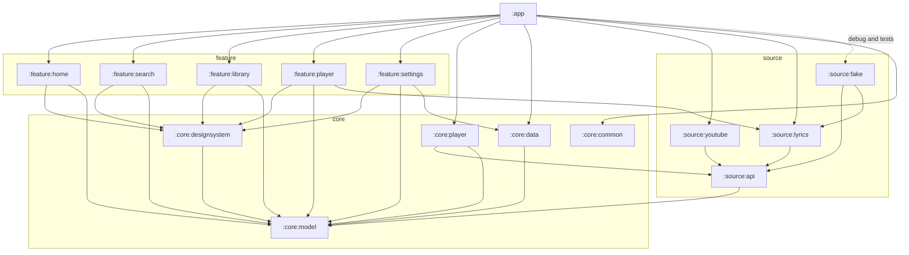
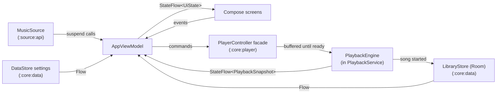
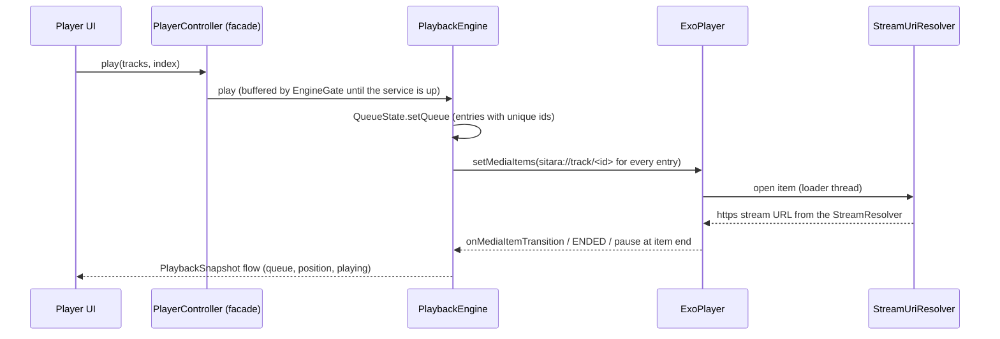
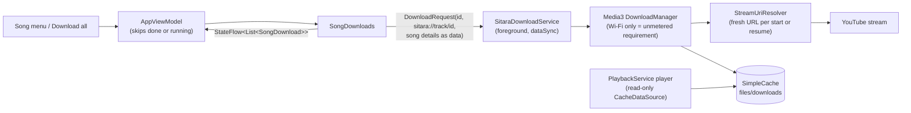
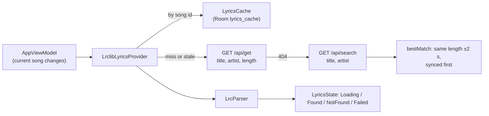
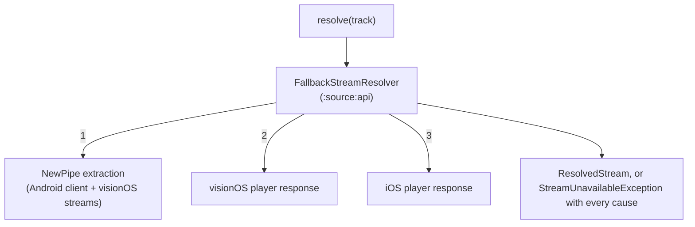
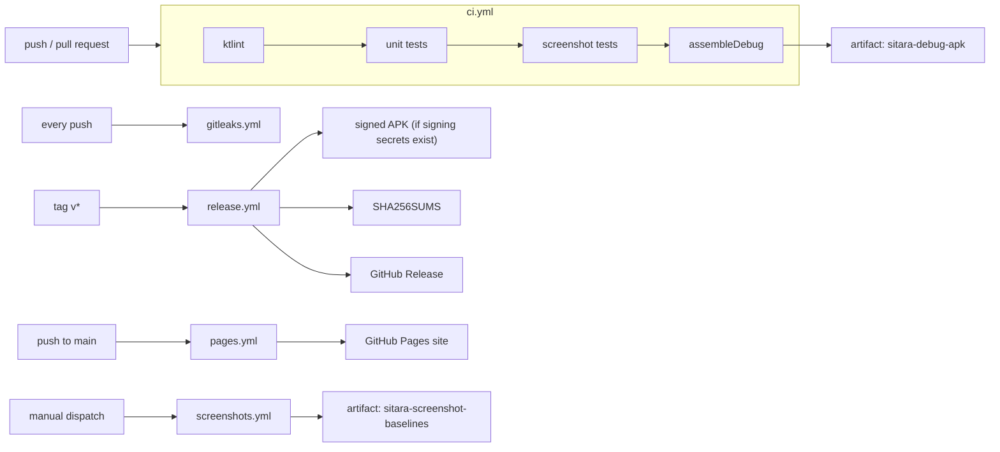

# Sitara architecture

This document describes how Sitara is put together: the module map, how data moves from a music source to the screen, how playback is wired to Media3, how stream lookups fall back, and how the code is tested and shipped.

> Status: Phase C slice 2 (after the complete Phase B). Home's trending chart, search, artist/album/playlist pages, radio and streams are live (YouTube through NewPipeExtractor); lyrics come from LRCLIB; the library, the play queue and fetched lyrics are stored on the device with Room; downloaded songs live in a Media3 cache and play offline; playback levels loudness, can crossfade, joins songs gapless, changes speed and pitch and can skip silence; covers load through Coil and colour the player. The app contains no sample data; the sample catalogue is a test and debug fixture. Modules marked *planned* do not exist yet.

## Goals

1. **Swap the source, keep the app.** Features talk to interfaces in `:source:api`, never to a concrete backend. A change on the streaming side is a one-module fix.
2. **Pure logic stays pure.** Queue rules, crossfade curves, loudness gain, sleep timer and the LRC parser are plain Kotlin with no Android types, so they are fast to test.
3. **One way to do each thing.** One motion object, one theme, one player controller, one settings store.
4. **Everything visible is tested.** Screens are covered by Roborazzi screenshot tests that also produce the README images.

## Module map

| Module | Kind | Responsibility |
| --- | --- | --- |
| `:app` | Android application | Activity, app shell (glass tab bar, mini player dock, detail back stack of typed `DetailRoute`s), dependency wiring |
| `:core:model` | Pure Kotlin | Domain types: `Track`, `Album`, `Artist`, `Playlist`, `Queue`, `LyricsLine`, `LyricsWord` |
| `:core:common` | Pure Kotlin | Result types, coroutine dispatchers, time and formatting helpers |
| `:core:data` | Android library | DataStore-backed settings (theme, motion, sound, Wi-Fi-only downloads); the on-device store (`LibraryStore`): repositories for liked songs, play history, saved albums and artists, playlists, the saved play queue and the lyrics cache, implemented with Room, whose schema is exported to `core/data/schemas` |
| `:core:player` | Android library | `PlaybackService` (Media3 session + ExoPlayer), `PlaybackEngine`, `PlayerController` facade, queue engine and its save/restore, controller/stream policies, sleep timer, `PrefetchingStreamResolver` (the next song's stream, looked up ahead); `SongDownloads` and `SitaraDownloadService` (Media3 downloads); `LoudnessLeveller` in a Media3 audio processor; `Crossfader` and its timing rules |
| `:core:designsystem` | Android library | Theme, colour roles, `SitaraMotion`, glass surfaces, typography, icons, shared components; covers: the Coil image loader (memory and disk cache), cover URLs sized to their slot, square crops of video thumbnails, the cover palette and its contrast-checked stage theme |
| `:source:api` | Pure Kotlin | Contracts: `SearchSource`, `ChartsSource`, `MusicSource`, `BrowseSource` (artist, album, playlist pages), `RadioSource`, `StreamResolver`, `LyricsProvider`, `HealthCheck` |
| `:source:fake` | Pure Kotlin | Deterministic sample catalogue whose `sample:cover/` images the debug image loader draws from their colours: a fixture for tests, screenshots and the debug capture screen (`debugImplementation` only, never in a release build) |
| `:source:lyrics` | Pure Kotlin (JVM) | LRC and enhanced (word-timed) LRC parser; `LrclibLyricsProvider` (LRCLIB over OkHttp, cached through a `LyricsCache`) and the title clean-up for lyric searches |
| `:feature:home` | Android library | Home: the trending chart (loading, error, retry) and shelves from the library: Recently played, Jump back in, From your likes |
| `:feature:search` | Android library | Search field, suggestions, results; debounced search states with loading, error and retry |
| `:feature:library` | Android library | Library (liked songs, playlists, shelves, Downloads with progress, cancel, delete and retry), song menus, and the artist, album and playlist detail pages with loading, error and empty states, Download all and downloaded badges |
| `:feature:player` | Android library | Mini player, full player sheet, scrubber, Up next / Lyrics pager, karaoke lyrics, speed and pitch sheet, sleep timer sheet |
| `:feature:settings` | Android library | Theme, reduced motion, Sound (normalise loudness, skip silence, crossfade), Downloads (Wi-Fi only, storage used, Remove all) |
| `:source:youtube` | Pure Kotlin (JVM) | YouTube Music search (songs, albums, artists, playlists), artist/album/playlist pages, radio from related songs, the YouTube Charts trending list (NewPipe's `trending_music` kiosk), YouTube link parsing and audio stream resolution on NewPipeExtractor, with an OkHttp downloader ([ADR 0004](adr/0004-youtube-source-newpipeextractor.md)) |
| `:source:local` | *planned, Phase B* | MediaStore and folder-based local files |

## Dependency graph

Arrows point from a module to the modules it depends on (direct project dependencies only). Feature modules never depend on each other; anything shared moves down into a core module. `:core:common` is a leaf module with no project dependencies.

Rules enforced in review:

- `:core:model`, `:core:common`, `:source:api`, `:source:fake`, `:source:lyrics` and `:source:youtube` stay free of Android dependencies.
- Only `:app` chooses concrete sources. Home's chart, search, detail pages, radio and streams use YouTube (`YouTubeMusicSource`, `youTubeStreamResolver()`); lyrics use `LrclibLyricsProvider`; the Library tab and Home's shelves read only `LibraryStore`. The sample source is a fixture: it reaches only debug builds and tests.
- UI modules depend on `:core:designsystem` for every colour, shape, spring and duration. Hard-coded values in feature code are a review comment.

## Data flow

Sitara follows unidirectional data flow. State flows down as immutable objects; user intent flows up as events.

1. **Source.** A `MusicSource` exposes suspending calls and flows for home shelves, search, albums, playlists and track metadata, returning `:core:model` types.
2. **ViewModel.** In Phase A one `AppViewModel` combines the fake source, settings and playback state into immutable UI state exposed as `StateFlow`. Repositories with caching arrive with the real source in Phase B.
3. **Errors.** `:core:common` provides an `Outcome` type for results that can fail.
4. **Compose.** Screens are stateless functions of `UiState` plus an event callback. This is what makes them easy to preview and screenshot-test with fake state.
5. **Settings.** Theme mode, reduced motion and playback preferences live in DataStore and are observed as flows, so changes apply instantly without restarts.

### Playback

- **The service owns playback.** `PlaybackService` creates ExoPlayer and a `PlaybackEngine` and keeps them for as
  long as the service lives. Screens only attach and detach, so auto-advance, system Next/Previous (notification,
  Bluetooth, Android Auto) and the sleep timer keep working with no UI.
- **`PlayerController` is a facade.** Connecting a `MediaController` binds the service. Commands go to the engine
  through `EngineGate`, which buffers anything sent before the engine exists and replays it once. Reconnecting never
  reloads the player.
- **The queue engine is pure Kotlin** (`QueueState`). Entries carry unique ids, so a track queued twice is
  unambiguous. Shuffle keeps the original order, so turning shuffle off restores it with the same entry selected.
  The engine mirrors the queue into ExoPlayer as a playlist: shuffling reorders around the playing item without
  reloading it, and repeat modes map onto the player's.
- **Streams are resolved lazily.** Items use `sitara://track/<id>` URIs; a `ResolvingDataSource` asks the
  `StreamResolver` for a URL when ExoPlayer opens the item. Only `sitara://` and https may be loaded (`StreamPolicy`).
- **The session is filtered.** `ControllerPolicy` gives the app (identified by binder uid) full access, gives system
  surfaces transport controls only, and rejects other apps. External media items are refused.
- **The queue survives the process.** `PlaybackService` asks the app for the saved queue when it starts and
  `PlaybackEngine.restore`s it paused at the same song and position, unless the listener already queued something.
  `keepSaving` hands the app the queue once a change settles (1 s), whenever playback pauses, every 15 s while
  playing and when the service is destroyed; an empty queue never overwrites the saved one. The conversion
  (`QueueState.toSaved` / `SavedQueue.toQueueState`) is pure: play order, the unshuffled order as indices, the
  current index, position and repeat mode, with fresh entry ids on the way back. Room keeps it in `queue_entries`
  and a one-row `queue_state`; a save that only moves the position rewrites that one row.
- **Resuming without the app.** `MediaButtonReceiver` starts the service for a headset or Bluetooth play button,
  and `onPlaybackResumption` restores the saved queue and hands its items to Media3 (also for Android's resume card).
- **System controls.** Media items carry title, artist, album and the cover URL; the session's bitmap loader fetches
  the cover for the notification, lock screen and Bluetooth displays. ExoPlayer handles audio focus (ducks, pauses
  for a call and resumes after it) and pauses when the output becomes noisy (headphones unplugged, Bluetooth gone).
  The service keeps running when the app is swiped away while music plays, and stops if it is paused or empty.
- **The sleep timer** counts minutes on `elapsedRealtime` (monotonic) toward a deadline it re-reads every second, so
  extending a running timer moves the deadline without a restart; or it pauses at the end of the current item using
  ExoPlayer's pause-at-end.
- **Gapless joins.** The engine works out the entry the player moves to by itself (`QueueState.followingEntry`: the
  next one, the first one under repeat all, none under repeat one, at the end of the queue or when the sleep timer
  stops after this song). Once playback runs, each new following entry is handed to `PrefetchingStreamResolver`, which
  resolves its stream in the background and holds it (one song; a newer one cancels the lookup; a failed or
  30-minute-old one is looked up again). When ExoPlayer's loader reaches that item, the stream is ready, so the
  playlist joins without inserted silence. Downloaded songs are skipped; they play from the cache.
- **Speed and pitch** (`PlaybackTuning` in `:core:model`) are ExoPlayer playback parameters: speed 0.5 to 2 in steps of
  0.05, pitch as a ratio of 2^(semitones/12) for ±6 semitones. The engine holds them for the service's life (not
  saved), applies them through `PlayerPort.setTuning`, and the crossfade tail copies them. Positions stay in media
  time, so lyrics follow the song at any speed.
- **Skip silence** sets `skipSilenceEnabled` on both players, which switches Media3's silence-skipping processor in the
  audio chain after the leveller.
- **Downloaded songs play from the download cache.** The player's data source is a read-only `CacheDataSource` over
  the download cache, keyed by the `sitara://track/<id>` URI, with the resolving data source as its upstream. A
  downloaded song is read from the device and never resolved; any other song streams and is not written to the
  cache. See [Downloads](#downloads).
- **Normalisation** (`LoudnessLeveller`, run by `SoundAudioProcessor` in ExoPlayer's audio sink). NewPipeExtractor
  does not pass on YouTube's loudness values (`ResolvedStream.loudnessLufs` stays empty), so the level is measured as
  it plays: the gated (above −50 dBFS) RMS level over about 3 s, unweighted, as an approximation of LUFS; gain toward
  the target (−14 LUFS by default), at most +6 dB and at most −15 dB, moving no faster than 3 dB/s down and 1 dB/s up,
  ramped across each buffer, and a boost never lifts a peak past −1 dBFS. Off, audio passes through bit-exact.
  16-bit and float PCM are levelled; other encodings pass by.
- **Crossfade** (`Crossfader`, timing rules in `Crossfade`). Ten seconds before the last N seconds of a song, a second
  ExoPlayer (the tail, without audio focus) loads that song at the fade point, and a `PlayerMessage` fires when the
  main player reaches it. The tail starts; once its output runs, both play the same audio for 80 ms while the main
  player's volume goes to zero; then the main player seeks to the next item and the two fade with equal-power curves,
  timed by the tail's own position. The main player keeps the session, the queue, the engine's state and the saved
  position, so system controls, Up next edits, persistence and restore work exactly as without crossfade. Songs from
  the same album (gapless), repeat one, an end-of-song sleep stop, the end of the queue and songs shorter than two
  fades do not fade. Pausing, seeking, skipping, any other item change, an interruption (a call) or a settings change
  stops the tail and restores full volume; a tail that is not ready in time, stalls or fails falls back to the normal
  gapless change or ends the fade on time. The tail's leveller starts from the main player's level.
- **Lyrics** are parsed into timed lines and words, keeping the original text and syllables. The UI derives the active
  line and the karaoke character sweep from the position; unsynced lyrics are shown as static text.

### Downloads

- A download is Media3's `DownloadRequest` with the song id as its id and `sitara://track/<id>` as its URI, the same
  URI the player loads, so both use the same cache key. The download's data source resolves the stream with the same
  `StreamUriResolver` (it reads the song from the request's data), so a resumed download gets a fresh signed URL.
- The song's details (title, artist, album, length, cover colours and URL, artist id) are encoded into the request's
  data (`DownloadedTrack`, a versioned binary format; unreadable entries are skipped), so the Downloads list needs
  neither the network nor a Room migration.
- `SongDownloads` mirrors Media3's download index into a `StateFlow` of `SongDownload`s (newest first), polling
  progress once a second only while something downloads, and maps Media3 states to `DownloadState`: waiting, waiting
  for Wi-Fi, waiting for a connection, downloading (percent), downloaded, failed.
- `SitaraDownloadService` is a Media3 `DownloadService` in the foreground with a progress notification, so downloads
  finish after the app closes. It has no scheduler: while a download waits for Wi-Fi the service stays in the
  foreground (Android 12 and later allow nothing else). Opening the app resumes downloads left over from a killed
  process.
- "Wi-Fi only" (on by default) sets the manager's requirement to an unmetered network; off, any network.
  "Remove all downloads" removes every download and its cached data. Storage used is the sum of downloaded bytes.

### Lyrics

- `LyricsProvider` (`:source:api`) returns parsed `Lyrics`, null for "none", and throws when the service fails.
- `LrclibLyricsProvider` cleans the video title first (`lyricsQuery`: drops "(Official Video)"-style labels and a
  " | …" tail, reads "Artist - Song" titles), asks `/api/get` and falls back to `/api/search`. It stores the raw
  LRC and plain text, so a parser change never needs a cache migration. Found lyrics stay cached; "none found" is
  asked again after a week; errors are not cached. Requests carry `User-Agent: Sitara (<repository URL>)` and
  nothing else about the device or listener.
- The view model looks lyrics up when the current song changes (a retry asks again for the same song); the
  Lyrics page shows loading, the lyrics with an "LRCLIB" credit, "No lyrics found", or an error with Try again.

## Stream source fallback

The most common failure in streaming clients is the upstream service changing or refusing one client. Sitara treats that as a normal operating condition rather than an emergency.

- `StreamResolver` turns a track into a playable stream. `youTubeStreamResolver()` registers three routes in a fixed order: NewPipe's full extraction (`YouTubeStreamResolver`), then the visionOS and iOS clients asked directly through NewPipe's `YoutubeStreamHelper` (`ClientStreamResolver`). NewPipe's extraction fails as a whole when YouTube refuses its Android request (UNPLAYABLE, LOGIN_REQUIRED), which is why the other clients are asked on their own.
- `FallbackStreamResolver` tries the routes in order and stops at the first stream. The route that served a song is asked first for that song for the rest of the process. When every route fails, the exception carries each cause (also as suppressed exceptions, so logcat shows them).
- None of the routes passes a bot check aimed at the device's network, and YouTube can close any of them. A proof-of-origin token provider is still open.
- When every route fails, the player stops with an error. `PlaybackEngine.onPlayerError` marks that queue entry as failed; Now Playing swaps the scrubber for "Couldn't play this song" with Try again and Skip, and the mini player swaps Play for the same two actions. Try again reloads the song from where it stopped, which looks the stream up afresh. A failure never skips on its own: a refusal usually hits the next song too, and auto-skipping would run through the whole queue in seconds.

## Testing strategy

| Layer | Tools | What is covered |
| --- | --- | --- |
| Pure logic | JUnit 4/5, Turbine, coroutine test time | Queue engine (unique entries, shuffle restore, repeat), playback engine against a fake player (queue hand-off, transitions, end-of-queue restart, sleep timer and its extension, restore, save triggers, a failed song (marked, retried, skipped, never skipped on its own), which song is prepared ahead after a skip, shuffle, queue edit and repeat change, speed and pitch), the one-slot stream prefetch (hand-over, wait, replace, failure, expiry), speed and pitch limits, lyric timing at 1.5x, saved queue round trip (shuffle order, broken data), Home feed shelves, download state mapping and the downloaded-song codec, Download all selection, byte formatting, loudness levelling (target, boost cap, gate, slew, peak ceiling, bit-exact when off), crossfade rules and curve, LRCLIB lookups against an interceptor (exact, search fallback, best match, cache freshness, errors, User-Agent), lyric title clean-up, an LRCLIB-shaped LRC fixture (offset, repeated timestamps, blank break), command gate, controller and stream policies, crossfade and LUFS maths, LRC and enhanced LRC parsing, karaoke sweep, sheet geometry, palette to theme mapping, settings codec, fake source, YouTube song mapping, audio stream selection, OkHttp downloader request/response mapping (interceptor, no network), stream fallback order and per-song memory, player-response audio selection and refusals, search states |
| Library store | Robolectric, in-memory Room | Liked songs, capped history and its last-play order, saved albums and artists, playlist order, duplicates, renumbering, rename, delete cascading to entries, name validation, song details surviving storage; saved queue (repeats, shuffle order, replace, clear, position-only saves) and the lyrics cache |
| Playback service | Robolectric | The real `PlaybackService` restores a saved queue paused at its song, position and repeat mode, and saves it on destroy; normalisation, skip silence and crossfade follow setting changes while it runs; media item titles and covers are covered by `Media3PlayerPortTest` |
| Screenshots | Roborazzi on Robolectric (debug variant) | Home, search, library (with Downloads), album page with downloaded badges, player, lyrics, song menus and settings (Sound, Downloads) in light and dark; CI fails on any pixel mismatch against the committed baselines in `app/src/test/screenshots` |

Principles:

- Tests run on the JVM; no emulator is needed for the main suite.
- The fake source is deterministic (stable ids, titles and generated covers), so screenshots are stable across runs.
- A bug fix starts with a failing test.
- Screenshot diffs are reviewed like code. An intentional UI change re-records the baselines with `screenshots.yml`, and they are reviewed and committed with that change.
- Not covered by automated tests yet: real downloads and offline playback, how levelling and the crossfade hand-over
  sound, real stream playback, the player's audio attributes, audio focus and noisy-output behaviour on hardware, the notification's look, playback resumption from a media button, and gesture feel. Those need an on-device check.

## CI pipeline

All automation runs on GitHub Actions.

| Workflow | Trigger | Purpose |
| --- | --- | --- |
| `ci.yml` | Push and pull request | ktlint, unit tests, screenshot verification, `assembleDebug`, upload `sitara-debug-apk` |
| `release.yml` | Tags matching `v*` | Builds the release APK, signs it when the signing secrets are configured, writes `SHA256SUMS`, publishes a GitHub Release |
| `pages.yml` | Push to `main` | Publishes `site/` to GitHub Pages, copying in `docs/assets` and `docs/screenshots` |
| `gitleaks.yml` | Push and pull request | Scans for committed secrets |
| `screenshots.yml` | Manual | Records Roborazzi baselines on the CI runner image and uploads them as an artifact; a maintainer reviews and commits them |

Signing keys never live in the repository. They are provided only as encrypted GitHub Actions secrets; without them the release workflow still produces an unsigned build and says so.
