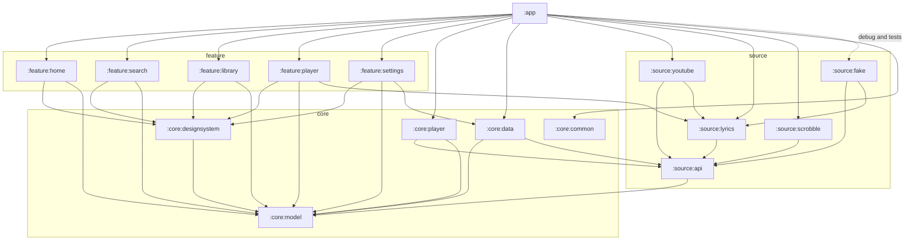
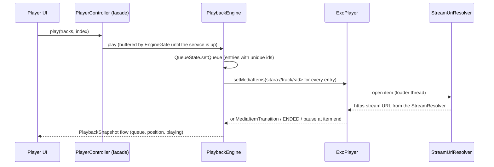
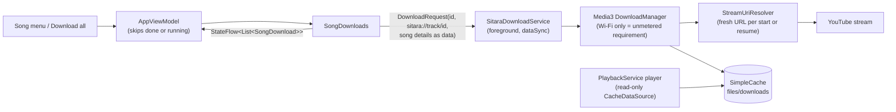
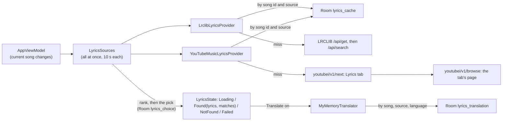
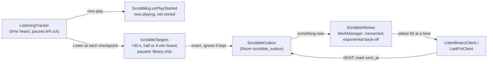
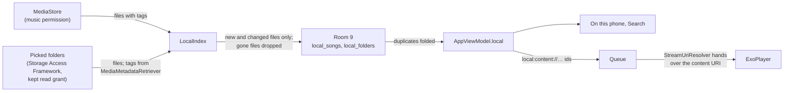
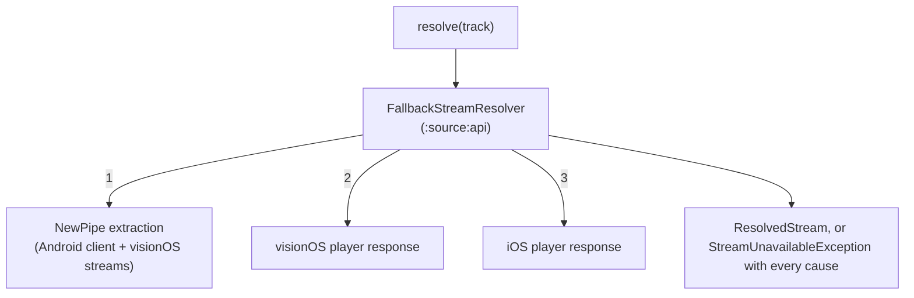
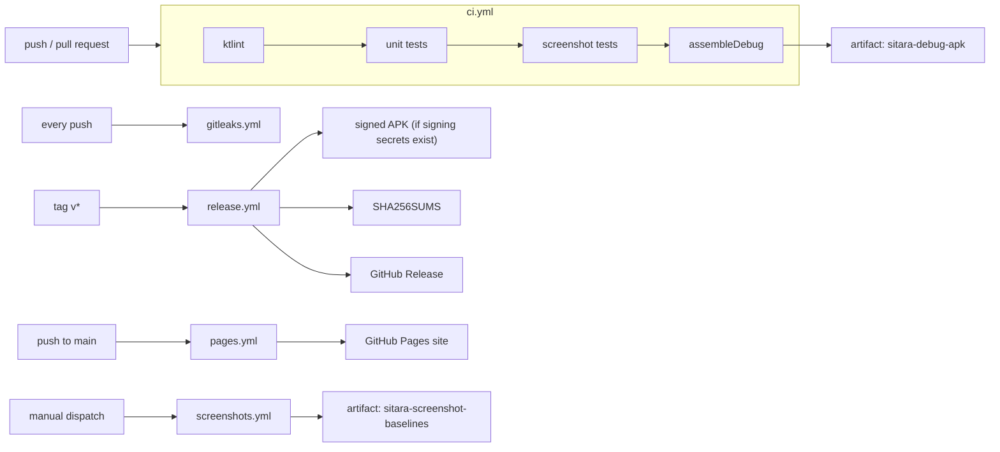

# Sitara architecture

This document describes how Sitara is put together: the module map, how data moves from a music source to the screen, how playback is wired to Media3, how stream lookups fall back, and how the code is tested and shipped.

> Status: polish slice 10 (after Phase C slice 3). Home (YouTube Music's own Home, with the trending chart in its place when it fails), search with suggestions and Moods & genres, artist/album/playlist pages, radio and streams are live (YouTube through NewPipeExtractor); lyrics come from LRCLIB and YouTube Music, ranked and cached per source, with opt-in translation by MyMemory and shareable lyric cards; the library, the play queue and fetched lyrics are stored on the device with Room; downloaded songs live in a Media3 cache and play offline; playback levels loudness, can crossfade, joins songs gapless, changes speed and pitch and can skip silence; covers load through Coil and colour the player, and, if the listener chooses, the whole app; Android Auto browses the library through a media library service, and a Glance widget shows what plays on the home screen; plays can be scrobbled to ListenBrainz and Last.fm through an outbox kept in Room; playlists come in from YouTube links and M3U/CSV files through a resumable import, and streams follow a quality setting per network; songs saved on the phone and in picked folders are indexed into Room and play like streamed ones, and the library and settings go to and come back from a versioned JSON backup. The app contains no sample data; the sample catalogue is a test and debug fixture. Modules marked *planned* do not exist yet.

## Goals

1. **Swap the source, keep the app.** Features talk to interfaces in `:source:api`, never to a concrete backend. A change on the streaming side is a one-module fix.
2. **Pure logic stays pure.** Queue rules, crossfade curves, loudness gain, sleep timer and the LRC parser are plain Kotlin with no Android types, so they are fast to test.
3. **One way to do each thing.** One motion object, one theme, one player controller, one settings store.
4. **Everything visible is tested.** Screens are covered by Roborazzi screenshot tests that also produce the README images.

## Module map

| Module | Kind | Responsibility |
| --- | --- | --- |
| `:app` | Android application | Activity, app shell (glass tab bar, mini player dock, detail back stack of typed `DetailRoute`s), dependency wiring (including `LibraryContent` for the car, from Room, the download index and YouTube Music; the import's YouTube catalogue and file reading; the stream quality per network and the recorded stream formats), the home-screen widget (`widget/`: Jetpack Glance, `WidgetState` and its throttled redraws, cover colours, action callbacks) |
| `:core:model` | Pure Kotlin | Domain types: `Track`, `Album`, `Artist`, `Playlist`, `Queue`, `LyricsLine`, `LyricsWord`; `Listen`, `StatsRange` (local-midnight bounds) and `ListeningStats` (top songs, artists, albums, time heard by hour) |
| `:core:common` | Pure Kotlin | Result types, coroutine dispatchers, time and formatting helpers |
| `:core:data` | Android library | DataStore-backed settings (theme, motion, sound, Wi-Fi-only downloads, the search filter and recent searches, Library's layout and order); the on-device store (`LibraryStore`): repositories for liked songs, play history (every play that counted, with its start and time heard; plays per song; listening stats for a range), saved albums and artists, playlists, the saved play queue, the lyrics cache and per-song volume trims, implemented with Room, whose schema is exported to `core/data/schemas`; the scrobble outbox and the scrobbling accounts with their Keystore-sealed tokens (`scrobble/`); playlist imports (`imports/`: pure M3U and CSV parsers, the match score, and `PlaylistImporter`, a job kept row by row in Room so it resumes without duplicates and a repeat import updates its playlist); songs on the phone (`local/`: `LocalIndex` over MediaStore and picked folders, see [Songs on the phone](#songs-on-the-phone)); backups (`backup/`: `LibraryBackups` and the JSON format, see [Backup and restore](#backup-and-restore)) |
| `:core:player` | Android library | `PlaybackService` (Media3 media library session + ExoPlayer; `LibraryBrowser` turns stable media ids into the car's browse tree, pages and search; `WordedErrors` words a failed song's error for system surfaces), `PlaybackEngine`, `PlayerController` facade, queue engine and its save/restore, controller/stream policies, the notification's Like, Shuffle and Repeat (`SessionActions`, custom session commands for system surfaces only), radio-tagged queue entries and Undo of a removal, `ListeningTracker` (time heard per entry on the monotonic clock; a play counts after 30 s or half the song; each new play announced for scrobbling's now playing), sleep timer, `PrefetchingStreamResolver` (the next song's stream, looked up ahead); `SongDownloads` and `SitaraDownloadService` (Media3 downloads); `LoudnessLeveller` in a Media3 audio processor; `Crossfader` and its timing rules |
| `:core:designsystem` | Android library | Theme (six tuned accents, or the wallpaper's or the cover's walked to 4.5:1 on every surface; surfaces tinted from the playing cover; pure black), colour roles, `SitaraMotion`, glass surfaces, typography, icons, shared components; covers: the Coil image loader (memory and disk cache), cover URLs sized to their slot, square crops of video thumbnails, the cover analysis (main and vibrant colours, the brightest blurred colour, a 12 px copy for phones without blur), its contrast-checked themes for the stage and the dock, and the stage backdrop whose shade is worked out per cover |
| `:source:api` | Pure Kotlin | Contracts: `SearchSource`, `SearchSuggestionSource`, `ChartsSource`, `HomeFeedSource`, `ScrobbleClient`, `MoodsSource`, `MusicSource`, `BrowseSource` (artist, album, playlist pages), `RadioSource`, `StreamResolver`, `LyricsProvider`, `HealthCheck` |
| `:source:fake` | Pure Kotlin | Deterministic sample catalogue whose `sample:cover/` images the debug image loader draws from their colours: a fixture for tests, screenshots and the debug capture screen (`debugImplementation` only, never in a release build) |
| `:source:scrobble` | Pure Kotlin (JVM) | `ListenBrainzClient` (token check, submit-listens) and Last.fm (`LastFmAuth` web sign-in, `LastFmClient`, signed calls) over OkHttp, answers mapped to `SendOutcome` |
| `:source:lyrics` | Pure Kotlin (JVM) | LRC and enhanced (word-timed) LRC parser; `LrclibLyricsProvider` (LRCLIB over OkHttp, cached through a `LyricsCache`) and the title clean-up for lyric searches; `LyricsSources` (every provider at once, ranked, a timeout per source, the listener's pick through `LyricsChoices`); `MyMemoryTranslator` (batched lines, cached through a `TranslationCache`) |
| `:feature:home` | Android library | Home: `OnlineHomeLoader` (the catalogue's Home page by page, mood chips, the trending chart when the feed fails) and the screen: chips, Quick picks pages, cover carousels, Listen again, Your likes, Jump back in, placeholders and the offline card; `MoodScreen`, a mood or genre page drawn with the same shelves |
| `:feature:search` | Android library | Search field, results with debounced states (loading, error, retry); with nothing typed, recent searches and Moods & genres tiles; suggestions while typing with recent searches as the fallback |
| `:feature:library` | Android library | Library (Liked songs and Downloads pinned, Recently played, playlists, songs, albums, artists or downloads as a grid or a list, `LibraryOrder` for the orders each kind offers, playlist collages; Downloads with progress, cancel, delete and retry), song menus, On this phone (`LocalScreen`: songs, albums, artists and folders of the phone's music, picked folders with Relink, the album/artist/folder page), Import playlist (link or file, progress counts, review of uncertain matches, worded problems), Your stats (ranges, totals, the hour chart, top songs, artists and albums, the share card sent through the app's FileProvider), and the artist, album and playlist detail pages with loading, error and empty states, Download all and downloaded badges |
| `:feature:player` | Android library | Mini player, full player sheet, scrubber, Up next (swipe to remove with Undo, Save as playlist, radio's own section) / Lyrics pager, karaoke lyrics with the source chip and sheet, Translate and its language sheet, lyric cards (line picking, three styles, the 1080 × 1350 card), speed and pitch sheet, sleep timer sheet |
| `:feature:settings` | Android library | Appearance (theme, pure black, wallpaper colours, accents, artwork colours across the app, live preview), reduced motion, Playback (stream quality on Wi-Fi and on mobile data), Library (Import playlist, Backup and restore with its worded outcomes), Sound (normalise loudness, skip silence, crossfade), Listening history (Your stats, Scrobbling with ListenBrainz and Last.fm, Pause, Clear), Downloads (Wi-Fi only, storage used, Remove all) |
| `:source:youtube` | Pure Kotlin (JVM) | YouTube Music search (songs, albums, artists, playlists), artist/album/playlist pages, radio from related songs, the YouTube Charts trending list (NewPipe's `trending_music` kiosk), YouTube Music's Home (`FEmusic_home` asked directly over NewPipe's HTTP layer as the WEB_REMIX client, chips and continuations, parsed in `HomeFeedParsing`), search suggestions and Moods & genres with their pages (`ExploreParsing`, the same client), YouTube song and playlist link parsing, whole playlists for imports, and audio stream resolution on NewPipeExtractor at a quality asked for per lookup (with the codec named), with an OkHttp downloader ([ADR 0004](adr/0004-youtube-source-newpipeextractor.md)); YouTube Music's lyrics (`YouTubeMusicLyricsProvider`: the watch page's Lyrics tab) |

## Dependency graph

Arrows point from a module to the modules it depends on (direct project dependencies only). Feature modules never depend on each other; anything shared moves down into a core module. `:core:common` is a leaf module with no project dependencies.



Rules enforced in review:

- `:core:model`, `:core:common`, `:source:api`, `:source:fake`, `:source:lyrics` and `:source:youtube` stay free of Android dependencies.
- Only `:app` chooses concrete sources. Home's chart, search, detail pages, radio and streams use YouTube (`YouTubeMusicSource`, `youTubeStreamResolver()`); lyrics use `LrclibLyricsProvider` and `YouTubeMusicLyricsProvider` through `LyricsSources`, translations `MyMemoryTranslator`; the Library tab and Home's shelves read only `LibraryStore`. The sample source is a fixture: it reaches only debug builds and tests.
- UI modules depend on `:core:designsystem` for every colour, shape, spring and duration. Hard-coded values in feature code are a review comment.

## Data flow

Sitara follows unidirectional data flow. State flows down as immutable objects; user intent flows up as events.


1. **Source.** A `MusicSource` exposes suspending calls and flows for home shelves, search, albums, playlists and track metadata, returning `:core:model` types.
2. **ViewModel.** In Phase A one `AppViewModel` combines the fake source, settings and playback state into immutable UI state exposed as `StateFlow`. Repositories with caching arrive with the real source in Phase B.
3. **Errors.** `:core:common` provides an `Outcome` type for results that can fail.
4. **Compose.** Screens are stateless functions of `UiState` plus an event callback. This is what makes them easy to preview and screenshot-test with fake state.
5. **Settings.** Theme mode, reduced motion and playback preferences live in DataStore and are observed as flows, so changes apply instantly without restarts.

### Playback



- **The service owns playback.** `PlaybackService` creates ExoPlayer and a `PlaybackEngine` and keeps them for as
  long as the service lives. Screens only attach and detach, so auto-advance, system Next/Previous (notification,
  Bluetooth, Android Auto) and the sleep timer keep working with no UI.
- **`PlayerController` is a facade.** Connecting a `MediaController` binds the service. Commands go to the engine
  through `EngineGate`, which buffers anything sent before the engine exists and replays it once. Reconnecting never
  reloads the player.
- **The queue engine is pure Kotlin** (`QueueState`). Entries carry unique ids, so a track queued twice is
  unambiguous. Shuffle keeps the original order, so turning shuffle off restores it with the same entry selected.
  The engine mirrors the queue into ExoPlayer as a playlist: shuffling reorders around the playing item without
  reloading it, and repeat modes map onto the player's.
- **Streams are resolved lazily.** Items use `sitara://track/<id>` URIs; a `ResolvingDataSource` asks the
  `StreamResolver` for a URL when ExoPlayer opens the item. Only `sitara://` and https may be loaded (`StreamPolicy`).
- **The session is filtered.** `ControllerPolicy` gives the app (identified by binder uid) full access, gives system
  surfaces transport controls only, and rejects other apps. External media items are refused.
- **The queue survives the process.** `PlaybackService` asks the app for the saved queue when it starts and
  `PlaybackEngine.restore`s it paused at the same song and position, unless the listener already queued something.
  `keepSaving` hands the app the queue once a change settles (1 s), whenever playback pauses, every 15 s while
  playing and when the service is destroyed; an empty queue never overwrites the saved one. The conversion
  (`QueueState.toSaved` / `SavedQueue.toQueueState`) is pure: play order, the unshuffled order as indices, the
  current index, position and repeat mode, with fresh entry ids on the way back. Room keeps it in `queue_entries`
  and a one-row `queue_state`; a save that only moves the position rewrites that one row.
- **Resuming without the app.** `MediaButtonReceiver` starts the service for a headset or Bluetooth play button,
  and `onPlaybackResumption` restores the saved queue and hands its items to Media3 (also for Android's resume card).
- **System controls.** Media items carry title, artist, album and the cover URL; the session's bitmap loader fetches
  the cover for the notification, lock screen and Bluetooth displays. ExoPlayer handles audio focus (ducks, pauses
  for a call and resumes after it) and pauses when the output becomes noisy (headphones unplugged, Bluetooth gone).
  The service keeps running when the app is swiped away while music plays, and stops if it is paused or empty.
- **The sleep timer** counts minutes on `elapsedRealtime` (monotonic) toward a deadline it re-reads every second, so
  extending a running timer moves the deadline without a restart; or it pauses at the end of the current item using
  ExoPlayer's pause-at-end.
- **Gapless joins.** The engine works out the entry the player moves to by itself (`QueueState.followingEntry`: the
  next one, the first one under repeat all, none under repeat one, at the end of the queue or when the sleep timer
  stops after this song). Once playback runs, each new following entry is handed to `PrefetchingStreamResolver`, which
  resolves its stream in the background and holds it (one song; a newer one cancels the lookup; a failed or
  30-minute-old one is looked up again). When ExoPlayer's loader reaches that item, the stream is ready, so the
  playlist joins without inserted silence. Downloaded songs are skipped; they play from the cache.
- **Speed and pitch** (`PlaybackTuning` in `:core:model`) are ExoPlayer playback parameters: speed 0.5 to 2 in steps of
  0.05, pitch as a ratio of 2^(semitones/12) for ±6 semitones. The engine holds them for the service's life (not
  saved), applies them through `PlayerPort.setTuning`, and the crossfade tail copies them. Positions stay in media
  time, so lyrics follow the song at any speed.
- **Skip silence** sets `skipSilenceEnabled` on both players, which switches Media3's silence-skipping processor in the
  audio chain after the leveller.
- **Downloaded songs play from the download cache.** The player's data source is a read-only `CacheDataSource` over
  the download cache, keyed by the `sitara://track/<id>` URI, with the resolving data source as its upstream. A
  downloaded song is read from the device and never resolved; any other song streams and is not written to the
  cache. See [Downloads](#downloads).
- **Normalisation** (`LoudnessLeveller`, run by `SoundAudioProcessor` in ExoPlayer's audio sink). NewPipeExtractor
  does not pass on YouTube's loudness values (`ResolvedStream.loudnessLufs` stays empty), so the level is measured as
  it plays: the gated (above −50 dBFS) RMS level over about 3 s, unweighted, as an approximation of LUFS; gain toward
  the target (−14 LUFS by default), at most +6 dB and at most −15 dB, moving no faster than 3 dB/s down and 1 dB/s up,
  ramped across each buffer, and a boost never lifts a peak past −1 dBFS. Off, audio passes through bit-exact.
  16-bit and float PCM are levelled; other encodings pass by.
- **Equaliser** (`Equaliser`, after the leveller in `SoundAudioProcessor`). Ten peaking biquads (RBJ cookbook, Q for
  one octave) at 31.25 Hz to 16 kHz, ±12 dB, in direct form I with double-precision state, after a preamp that also
  carries the current song's volume trim (`song_gain`, Room schema 3). Gains glide at 240 dB/s: the filters are
  re-designed every 32 frames and the preamp is ramped per sample, so moving a slider never clicks. A band at 0 dB keeps
  running until its memory has caught up with its input, then drops out; flat settings with no trim pass audio through
  bit for bit. Bands at or above 0.45 × the sample rate stay flat. Headroom is the listener's (each preset's preamp
  cancels its largest boost); a peak limiter with instant attack and a 40 dB/s release holds every sample under 0.99,
  so boosts squash rather than clip. A seek or a new stream (the processor's flush) clears the filter memory.
- **Phone equaliser** (`SystemEqualiserSession`). With "Use phone equaliser" on and an app answering
  `ACTION_DISPLAY_AUDIO_EFFECT_CONTROL_PANEL` (queried in the manifest), the built-in equaliser is set flat and the
  player's audio session is announced with `ACTION_OPEN_AUDIO_EFFECT_CONTROL_SESSION` while the player is buffering or
  ready; it is closed on idle or ended, when the listener switches back, when the session changes and when the service
  ends. The crossfade tail adopts the main player's audio session (reported asynchronously by ExoPlayer), so the
  phone's equaliser shapes it too. Settings → Sound → Equaliser opens the phone's panel for that session.
- **Crossfade** (`Crossfader`, timing rules in `Crossfade`). Ten seconds before the last N seconds of a song, a second
  ExoPlayer (the tail, without audio focus) loads that song at the fade point, and a `PlayerMessage` fires when the
  main player reaches it. The tail starts; once its output runs, both play the same audio for 80 ms while the main
  player's volume goes to zero; then the main player seeks to the next item and the two fade with equal-power curves,
  timed by the tail's own position. The main player keeps the session, the queue, the engine's state and the saved
  position, so system controls, Up next edits, persistence and restore work exactly as without crossfade. Songs from
  the same album (gapless), repeat one, an end-of-song sleep stop, the end of the queue and songs shorter than two
  fades do not fade. Pausing, seeking, skipping, any other item change, an interruption (a call) or a settings change
  stops the tail and restores full volume; a tail that is not ready in time, stalls or fails falls back to the normal
  gapless change or ends the fade on time. The tail's leveller starts from the main player's level.
- **Lyrics** are parsed into timed lines and words, keeping the original text and syllables. The UI derives the active
  line and the karaoke character sweep from the position; unsynced lyrics are shown as static text.
- **Android Auto** connects to `PlaybackService`, a `MediaLibraryService` (the manifest also lists the platform's
  `MediaBrowserService` action, and the app declares itself a car media app). `ControllerPolicy` gives the car `BROWSE`
  access: transport, the library commands and setting one media item; the notification keeps `PLAYBACK_ONLY`.
  `LibraryBrowser` (pure Kotlin) maps media ids such as `liked`, `album/<id>` and `song/<parent>/<track>` (segments
  URL-encoded) to `LibraryContent`, pages lists, reuses a catalogue answer for the song picked from it, and answers an
  empty search when YouTube Music cannot be reached. A picked song goes to the engine (`play(list, index)`), and the
  session is handed the engine's own playlist back, as for playback resumption. Like and Shuffle reach the car as the
  session's media button preferences, the same buttons as the notification.
- **The home-screen widget** (`:app`, Glance) reads `SitaraApplication.widgetStates`: the engine's state with the
  heart and whether a saved queue exists, passed through `shownWidgetStates`, which lets a change of song, play state,
  heart or failure through at once and position only in 15 s steps, and has the engine report its position every 15 s
  while playing. `updateAll` runs only with a widget placed. Buttons are Glance action callbacks that drive the engine
  on the main thread; with no player running, play goes to Media3's `MediaButtonReceiver`, which starts the service in
  the foreground and resumes the saved queue through `onPlaybackResumption`.

### Downloads



- A download is Media3's `DownloadRequest` with the song id as its id and `sitara://track/<id>` as its URI, the same
  URI the player loads, so both use the same cache key. The download's data source resolves the stream with the same
  `StreamUriResolver` (it reads the song from the request's data), so a resumed download gets a fresh signed URL.
- The song's details (title, artist, album, length, cover colours and URL, artist id) are encoded into the request's
  data (`DownloadedTrack`, a versioned binary format; unreadable entries are skipped), so the Downloads list needs
  neither the network nor a Room migration.
- `SongDownloads` mirrors Media3's download index into a `StateFlow` of `SongDownload`s (newest first), polling
  progress once a second only while something downloads, and maps Media3 states to `DownloadState`: waiting, waiting
  for Wi-Fi, waiting for a connection, downloading (percent), downloaded, failed.
- `SitaraDownloadService` is a Media3 `DownloadService` in the foreground with a progress notification, so downloads
  finish after the app closes. It has no scheduler: while a download waits for Wi-Fi the service stays in the
  foreground (Android 12 and later allow nothing else). Opening the app resumes downloads left over from a killed
  process.
- "Wi-Fi only" (on by default) sets the manager's requirement to an unmetered network; off, any network.
  "Remove all downloads" removes every download and its cached data. Storage used is the sum of downloaded bytes.

### Lyrics



- `LyricsProvider` (`:source:api`) returns parsed `Lyrics` (with the source's name, the text's licensor and the song the
  source matched: title, artist, length), null for "none", and throws when the service fails. Each provider caches its own
  raw answers by song id: found lyrics for good, "none found" for a week, errors never.
- **LRCLIB** (`LrclibLyricsProvider`) cleans the video title first (`lyricsQuery`: drops "(Official Video)"-style labels
  and a " | …" tail, reads "Artist - Song" titles), asks `/api/get` and falls back to `/api/search`. LRCLIB is a free,
  open lyrics database whose API needs no key or account and asks clients to identify themselves
  ([lrclib.net/docs](https://lrclib.net/docs)); requests carry `User-Agent: Sitara (<repository URL>)` and nothing about
  the device or listener.
- **YouTube Music** (`YouTubeMusicLyricsProvider`, `:source:youtube`) reads the Lyrics tab of a song's watch page with
  the same WEB_REMIX InnerTube requests the app already makes for Home and suggestions: `next` names the tab's browse id
  (by its `MUSIC_PAGE_TYPE_TRACK_LYRICS` page type), `browse` returns the plain text and its licensor ("Source:
  Musixmatch"). This is YouTube Music's own client interface, not a documented public API, like the rest of the app's
  YouTube access; it gives plain lyrics only. Tests use responses recorded from music.youtube.com, trimmed and with the
  lyric text replaced.
- No other source was added. The services checked either need a key or an account (Musixmatch, Genius, whose API does
  not return lyric text anyway) or are scrapers of other sites or unofficial endpoints (lyrics.ovh, NetEase, KuGou, QQ
  Music), which this project does not use.
- **Ranking** (`LyricsSources`): synced before plain, then lyrics whose matched song is as long as this one within 2 s
  (LRCLIB's own tolerance), then an exact title and artist (case-insensitive, against the title as uploaded or cleaned);
  ties keep the providers' order (LRCLIB, then YouTube Music). A source that throws or says nothing within 10 s is left
  out; with nothing found and a source failed, the lookup fails so it can be tried again. The source the listener picks
  in the sheet is kept per song (`lyrics_choice`) and comes first while it still has lyrics for the song.
- Room 7 keyed `lyrics_cache` by song and source (rows from version 6 became LRCLIB's) and added the matched song and the
  licensor; Try again on "No lyrics found" deletes the song's "none found" rows before asking again.
- **Translation** (`MyMemoryTranslator`): only while Translate is on, the shown lyrics' distinct non-blank lines go to
  MyMemory's public `GET /get` endpoint, joined with newlines in requests of at most 500 bytes, with
  `langpair=autodetect|<target>`; MyMemory needs no key, allows 5,000 characters a day per address for anonymous use
  ([usage limits](https://mymemory.translated.net/doc/usagelimits.php)), and is credited next to every translation.
  Lines MyMemory merges are asked one by one; a request answered "two distinct languages" leaves its lines as they were
  (all of them: "already in that language"). Failures are typed (`TranslationProblem`: offline, daily limit, same
  language, service) so the page words each one. Room 8 keeps translations per song, source and language
  (`lyrics_translation`). The target is the app's language until the listener picks another, which the settings keep.
- **Cards** (`LyricShareCard`, `LyricShareSheet`): the card is laid out at 360 × 450 dp at a fixed three pixels to the
  dp, so it is 1080 × 1350 px on any phone, and shown scaled to the sheet's width; Share image records the card into a
  `GraphicsLayer`, writes it as a PNG under the app's cache (`shared/`) and offers it through the FileProvider with read
  access for the chosen app only (`shareImage`, also used by the stats card).
- Lines take the full width so a right-to-left line (Urdu, Arabic) starts at the right edge; Bangla, Devanagari and
  Arabic-script text falls back from Inter to the system's fonts, checked in screenshot fixtures.

### Scrobbling



- The rule is the one Last.fm and ListenBrainz share (`scrobbleCounts` in `:core:model`): a song longer than 30 s
  counts once half of it, or 4 minutes, is heard. The time heard comes from `ListeningTracker`, so pauses and
  buffering add nothing, a seek adds only what is then played, and repeat-one starts a new play.
- `scrobble_outbox` (Room 6) keys each row by service, song and start, so the same play reported again at a
  later checkpoint is ignored, and each service has its own row. A row is marked `sent_at` once its service took it
  and kept for 30 days, so a play still being reported is never sent twice. A send cut off between the service's
  answer and the mark resends the same listen with the same start time, which the services are expected to keep as
  one listen (not checked against a real account).
- `ScrobbleOutbox.send` drains a service oldest first, 50 at a time (Last.fm's limit). A refused batch is sent again
  play by play and only a play refused on its own is dropped; "try later" (no connection, HTTP 429/5xx, Last.fm 11,
  16, 29) keeps every row and the worker returns `retry`; "sign in again" (HTTP 401, Last.fm 9) marks the account
  and plays keep waiting.
- `ScrobbleAccounts` keeps user names, Pause and "only songs in your library" in a DataStore of its own; tokens and
  session keys are sealed with AES-GCM under a key in the Android Keystore before they are written.
- Last.fm's API key and shared secret are build config fed by the `LASTFM_API_KEY` and `LASTFM_SHARED_SECRET` Gradle
  properties or environment variables (the release workflow's secrets); without them the Last.fm row says the
  build has no key.

### Songs on the phone



- **Ids.** A song on the phone has the id `local:` followed by its content URI (`localTrackId`, `Track.localUri` in
  `:core:model`). Likes, playlists, history, the saved queue, scrobbles and backups store it like any id and play the
  file without asking the index. `StreamUriResolver` returns that URI for a queued song instead of resolving a stream;
  only songs in the queue get that far, so the exported session cannot be used to open other content. The prefetcher,
  downloads (`toDownload`), radio and ListenBrainz's `origin_url` skip these ids, and YouTube Music's lyrics source
  ignores them (it reads video ids only); LRCLIB looks them up by their tags.
- **Readers** (`AndroidAudioReaders.kt`). `MediaStoreAudio` lists `IS_MUSIC` audio with its tags (title, artist, album,
  duration, track number; MediaStore's `TRACK` keeps the disc in the thousands). It runs only with `READ_MEDIA_AUDIO`
  (Android 13+) or `READ_EXTERNAL_STORAGE` (up to 12, `maxSdkVersion` 32), asked for from On this phone. `FolderAudio`
  walks a picked tree with `DocumentsContract` (audio MIME types) and reads tags with `MediaMetadataRetriever`; it runs
  only while `ContentResolver.persistedUriPermissions` holds the tree's read grant, taken with
  `takePersistableUriPermission` when the folder is picked.
- **Index** (`LocalIndex`). Each place (the phone's music, each folder) is scanned on its own: files whose size and
  modified time match the stored row keep it and their date added; new and changed files are read; rows for files that
  are gone are deleted, all in one transaction per place. A place that cannot be read (no permission, a revoked grant,
  a `SecurityException` mid-scan) keeps its rows, and a folder is marked `linked = false` until Relink folder picks it
  again. Missing or blank tags (and MediaStore's `<unknown>`) become the file name, "Unknown artist" and "Unknown
  album". A cover is the first embedded picture found for an album and artist, copied once into the app's files.
  Duplicates (same title, artist and album, lengths within 2 s) are folded when listed, the phone's copy first, so
  removing one copy brings the other back on the next scan.
- **When.** The app rescans when it starts, when On this phone opens or the app returns to it, after the permission
  answer, and after a folder is picked or relinked.

### Backup and restore

- `LibraryBackups.export` reads everything in one transaction (`BackupDao.snapshot`) and writes one JSON document with
  `org.json` (the platform's, no new dependency). The app writes it through `CreateDocument` with mode `"wt"`.
- `LibraryBackups.restore` parses the whole text and checks every value's type before anything is written: a cut-off
  file (it still names the format) is `DAMAGED`, other text is `NOT_A_BACKUP`, a higher `schemaVersion` is
  `NEWER_VERSION`. A good file replaces liked songs, saved albums and artists, playlists (new ids, same order), history,
  volume trims and lyric choices in one Room transaction (`BackupDao.replaceAll`); the settings map is then applied
  through `SettingsCodec`, so old keys carry over the way they do for an old install. The settings store is not part of
  the Room transaction. Repeats that the library cannot hold (a song twice in one playlist) are kept once.
- Out of a backup: the audio (downloads, files on the phone), picked folders and their grants, scrobbling accounts and
  their tokens, the saved queue and the caches (lyrics, translations, covers). Songs on the phone are kept by their
  content URI.
- `schemaVersion` 1 is the first; a change of shape bumps it and teaches `restore` to read the older one.

```json
{
  "format": "sitara-backup",
  "schemaVersion": 1,
  "appVersion": "0.10.0",
  "createdAt": 1792540800000,
  "liked": [{"track": {"id": "x7kGuhlXmFI", "title": "Paper Lanterns", "artist": "Orchid Lane", "album": "Harbour Lights",
             "durationMs": 214000, "artworkColors": [-6587393, 42], "artworkUrl": "https://…", "explicit": false,
             "artistId": "UC…"}, "likedAt": 1792500000000}],
  "savedAlbums": [{"id": "OLAK5uy_…", "title": "Harbour Lights", "artist": "Orchid Lane", "year": 2024,
                   "artworkColors": [-6587393], "savedAt": 1792500000000}],
  "savedArtists": [{"id": "UC…", "name": "Orchid Lane", "artworkColors": [-6587393], "savedAt": 1792500000000}],
  "playlists": [{"name": "Road trip", "createdAt": 1792400000000, "updatedAt": 1792450000000,
                 "songs": [{"track": {"id": "local:content://media/external/audio/media/42", "…": "…"}, "addedAt": 1792400000000}]}],
  "history": [{"track": {"…": "…"}, "playedAt": 1792300000000, "listenedMs": 182000},
              {"track": {"…": "…"}, "playedAt": 1700000000000, "listenedMs": null}],
  "songVolume": [{"trackId": "x7kGuhlXmFI", "trimDb": -3}],
  "lyricsSource": [{"trackId": "x7kGuhlXmFI", "provider": "youtube-music"}],
  "settings": {"dark_mode": "DARK", "translation_language": "bn", "…": "…"}
}
```

## Stream source fallback

The most common failure in streaming clients is the upstream service changing or refusing one client. Sitara treats that as a normal operating condition rather than an emergency.



- `StreamResolver` turns a track into a playable stream. `youTubeStreamResolver()` registers three routes in a fixed order: NewPipe's full extraction (`YouTubeStreamResolver`), then the visionOS and iOS clients asked directly through NewPipe's `YoutubeStreamHelper` (`ClientStreamResolver`). NewPipe's extraction fails as a whole when YouTube refuses its Android request (UNPLAYABLE, LOGIN_REQUIRED), which is why the other clients are asked on their own.
- `FallbackStreamResolver` tries the routes in order and stops at the first stream. The route that served a song is asked first for that song for the rest of the process. When every route fails, the exception carries each cause (also as suppressed exceptions, so logcat shows them).
- None of the routes passes a bot check aimed at the device's network, and YouTube can close any of them. A proof-of-origin token provider is still open.
- When every route fails, the player stops with an error. `PlaybackEngine.onPlayerError` marks that queue entry as failed; Now Playing swaps the scrubber for "Couldn't play this song" with Try again and Skip, and the mini player swaps Play for the same two actions. Try again reloads the song from where it stopped, which looks the stream up afresh. A failure never skips on its own: a refusal usually hits the next song too, and auto-skipping would run through the whole queue in seconds.

## Testing strategy

| Layer | Tools | What is covered |
| --- | --- | --- |
| Pure logic | JUnit 4/5, Turbine, coroutine test time | Queue engine (unique entries, shuffle restore, repeat), playback engine against a fake player (queue hand-off, transitions, end-of-queue restart, sleep timer and its extension, restore, save triggers, a failed song (marked, retried, skipped, never skipped on its own), which song is prepared ahead after a skip, shuffle, queue edit and repeat change, speed and pitch), the one-slot stream prefetch (hand-over, wait, replace, failure, expiry), speed and pitch limits, lyric timing at 1.5x, saved queue round trip (shuffle order, broken data), Home feed shelves, download state mapping and the downloaded-song codec, Download all selection, byte formatting, loudness levelling (target, boost cap, gate, slew, peak ceiling, bit-exact when off), crossfade rules and curve, LRCLIB lookups against an interceptor (exact, search fallback, best match, cache freshness, errors, User-Agent), lyric title clean-up, an LRCLIB-shaped LRC fixture (offset, repeated timestamps, blank break), command gate, controller and stream policies, crossfade and LUFS maths, LRC and enhanced LRC parsing, karaoke sweep, sheet geometry, palette to theme mapping, settings codec, fake source, YouTube song mapping, audio stream selection, OkHttp downloader request/response mapping (interceptor, no network), stream fallback order and per-song memory, player-response audio selection and refusals, search states |
| Library store | Robolectric, in-memory Room | Liked songs, capped history and its last-play order, saved albums and artists, playlist order, duplicates, renumbering, rename, delete cascading to entries, name validation, song details surviving storage; saved queue (repeats, shuffle order, replace, clear, position-only saves) and the lyrics cache |
| Playback service | Robolectric | The real `PlaybackService` restores a saved queue paused at its song, position and repeat mode, and saves it on destroy; normalisation, skip silence and crossfade follow setting changes while it runs; media item titles and covers are covered by `Media3PlayerPortTest` |
| Screenshots | Roborazzi on Robolectric (debug variant) | Home, search, library (with Downloads), album page with downloaded badges, player, lyrics, song menus and settings (Sound, Downloads) in light and dark; CI fails on any pixel mismatch against the committed baselines in `app/src/test/screenshots` |

Principles:

- Tests run on the JVM; no emulator is needed for the main suite.
- The fake source is deterministic (stable ids, titles and generated covers), so screenshots are stable across runs.
- A bug fix starts with a failing test.
- Screenshot diffs are reviewed like code. An intentional UI change re-records the baselines with `screenshots.yml`, and they are reviewed and committed with that change.
- Not covered by automated tests yet: real downloads and offline playback, how levelling and the crossfade hand-over
  sound, real stream playback, the player's audio attributes, audio focus and noisy-output behaviour on hardware, the notification's look, playback resumption from a media button, and gesture feel. Those need an on-device check.

## CI pipeline

All automation runs on GitHub Actions.



| Workflow | Trigger | Purpose |
| --- | --- | --- |
| `ci.yml` | Push and pull request | ktlint, unit tests, screenshot verification, `assembleDebug`, upload `sitara-debug-apk` |
| `release.yml` | Tags matching `v*` | Builds the release APK, signs it when the signing secrets are configured, writes `SHA256SUMS`, publishes a GitHub Release |
| `pages.yml` | Push to `main` | Publishes `site/` to GitHub Pages, copying in `docs/assets` and `docs/screenshots` |
| `gitleaks.yml` | Push and pull request | Scans for committed secrets |
| `screenshots.yml` | Manual | Records Roborazzi baselines on the CI runner image and uploads them as an artifact; a maintainer reviews and commits them |

Signing keys never live in the repository. They are provided only as encrypted GitHub Actions secrets; without them the release workflow still produces an unsigned build and says so.
