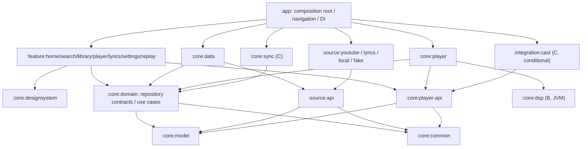
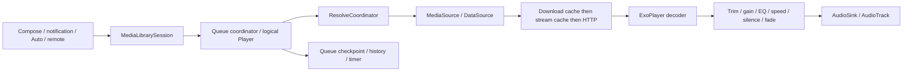

# Sitara Implementation Plan

> **For agentic workers:** Implement this plan task by task using the executing-plans skill, or subagent-driven-development if that execution method is selected. Checkboxes in Phase A track implementation work. This document authorizes no implementation by itself.

**Goal:** Deliver an original, GPL-3.0 Android music client with a distinctive, exceptionally fluid interface, resilient playback, and the feature coverage described in the supplied product specification and competitor study.

**Architecture:** A modular Android application with pure Kotlin contracts, a local-first repository layer, replaceable source adapters, and one service-owned playback session. Features observe immutable state and issue commands; they do not own players, extraction clients, or database connections.

**Tech stack:** Kotlin 2.4.x target, AGP 9.x, Compose 1.12 target, Material 3, Media3 1.10.x, Hilt/KSP, Room, Coroutines/Flow, Ktor, Coil 3, Haze, and deterministic JVM/device tests. Section 2 distinguishes requested version targets from verified compatibility evidence.

**Spec:** [SPEC.md](SPEC.md), supported by [STUDY.md](STUDY.md). Planning date: **2026-10-17**. The spec controls product decisions; the study supplies competitive observations, not independently verified release metadata or permission to reuse code.

## 1. Product contract and decisions

### 1.1 Global constraints

- Name **Sitara**; tagline **“Your music, beautifully.”**; application ID `app.sitara.music`.
- Original application code and visual assets; GPL-3.0 distribution, corresponding source, dependency notices, and open-license fonts/media. Determine the exact SPDX designation from the licenses actually adopted; do not silently change “GPL-3.0” into an “or later” grant.
- `minSdk 26`, `compileSdk 36`, `targetSdk 36`. Move compile/target to 37 only with a documented dependency/platform reason and a tested toolchain; do not import an opaque AAR that forces the change gratuitously.
- First performance reference: Galaxy S23 Ultra, Android 15/16, One UI, 120 Hz, 1440p. API 26 remains a functional supported baseline.
- Compose, type-safe Navigation Compose routes, Hilt, structured concurrency, Room, DataStore, Media3; no competitor application code, names, logos, screenshots, or bundled commercial music.
- One media playback service, offline-capable tests, generated screenshots, no secrets in source, gitleaks in CI and before pushes.
- No committed `gradle-wrapper.jar`. A documented, checksum-verified Gradle bootstrap must work from a fresh clone.
- No ad-blocking claims, no DRM circumvention, no promise that every YouTube item or account-only stream is playable. Show **“Not affiliated with YouTube or Google”** in About, README, and site.
- This deliverable is a plan only. Every future path and command below describes implementation work; no app, workflow, asset, or auxiliary document is created with this plan.

### 1.2 Engineering decisions that change how the spec is implemented

1. **Use `MediaLibraryService` as the single service.** It already extends `MediaSessionService`; creating separate playback and browse services would split ownership and notifications.
2. **True crossfade requires overlapping decoders.** An ordinary Media3 `AudioProcessor` processes one PCM stream and cannot fetch/decode/mix the next track by itself. Phase B uses two ExoPlayer decks with custom per-deck gain processors and one logical player facade; gapless uses a single-deck playlist path. A shared-sink mixer is a separate contingency, not hidden Phase A scope.
3. **Keep FOSS and Cast claims honest.** Inspect `media3-cast` and its transitive Google dependencies. A default FOSS artifact must exclude proprietary dependencies. A separate connected flavor is only distributable if its combined licensing is resolved; flavor separation alone does not cure GPL incompatibility.
4. **Encrypted app sync is independent of YouTube account sync.** App state has stable local identities and its own conflict rules. Authentication cookies, download bytes, and ephemeral stream URLs never enter app sync.
5. **No remotely downloaded extractor executable.** A fast fix means an isolated source-module change followed by a signed app release. Optional authenticated configuration can disable a broken resolver, but cannot inject code or switch to arbitrary endpoints.
6. **Phase A is a real vertical slice with fake discovery.** It has actual Media3 playback and system controls, not simulated playback state. Release notes clearly identify its demo catalog.
7. **Feature parity is capability parity, subject to the legal/non-goal contract.** Do not reproduce ReVanced patching, unofficial paid-stream access, or insecure account token tricks to satisfy a matrix cell.

### 1.3 Review focus

These five conditions drive explicit tests and release gates:

| Condition | Expected user outcome | Primary verification owner |
|---|---|---|
| Resolver returns a playable URL that expires, rate-limits, or stops after a minute | Bounded recovery retains queue and position; useful error if recovery fails | A06/A08 seams; B source chaos suite |
| Seek, next, Bluetooth disconnect, or timer occurs during a transition | No doubled playback, stuck attenuation, accidental resume, or duplicate history | A08–A11; B crossfade state-machine tests |
| Process dies while state or downloaded media is being committed | Library remains valid; playback restores paused; incomplete media is not advertised offline | A07/A08; B storage fault injection |
| Large fonts, RTL lyrics, missing artwork, reduced motion, or hot device | Controls remain usable; lyrics stay correctly shaped; motion degrades without losing meaning | A04/A09/A10/A12; B lyrics benchmarks |
| Two devices edit offline, including deletion, then reconnect | Deterministic merge, no resurrection of deleted entries, no leaked plaintext or tokens | A07 IDs; C sync convergence/property tests |

### 1.4 Coverage map

| Requirement group | Delivery and scope |
|---|---|
| Shell, glass navigation, artwork player, queue, timer, theme modes | A; visual polish continues through B |
| Search, home, artist/album/playlist browse, quality per network | B; fake equivalents in A |
| Background play, gapless, crossfade 0–12 s, normalization, system/built-in EQ, speed/pitch, skip silence | Background in A; DSP and real streams in B |
| Downloads, local MediaStore/SAF audio, tags, exported files and `.lrc` | B; distinguish managed downloads from user-owned exports |
| Local playlists, history, YouTube/Spotify public playlist imports, M3U/CSV, JSON backup | B; import progress and restartability are part of the feature |
| LRCLIB, LRC/enhanced LRC, provider choice, word rendering, lyric card | B; translation and Bangla/Hindi/Urdu transliteration in D |
| YouTube account library sync, Last.fm/ListenBrainz, Discord presence | C, with supported authentication/API gates |
| Spotify taste integration, recommendations, liked-library import, matching/manual override | C; authorized metadata integration, with B public-import foundation |
| Listen together, recognition, Glance widgets, Auto, Cast, Replay | C; Cast distribution has its own license/receiver gate |
| Animated canvas, beat-aware automix, Wear remote, TV layout | D; desktop client is outside this Android spec, although remote contracts permit one later |
| Sitara Sync: encrypted library/likes/history/settings | C; WebDAV first, then Drive app folder and optional encrypted gist adapter |
| LAN remote with web page | C; authenticated pairing, no Internet relay required |
| Smart offline and commute mode | B foundation; C adaptive scheduling and UI |
| Per-song gain/EQ/start/end trim and −14 LUFS target | B; actual loudness measurements and peak headroom required |
| Source health dashboard and diagnostics export | B; fake failure cases exercised in A |
| Accessibility, reduced motion, battery governor | A architecture and baseline acceptance; continuously tested |
| Fully FOSS/reproducible build, public tests and screenshots | A onward; verify release artifacts rather than merely asserting reproducibility |
| Lossless/pluggable sources from the study | Local FLAC/ALAC support where decoders permit in B; authorized external providers only behind later source adapters. Never label YouTube AAC/Opus as lossless |

## 2. Dependency baseline and compatibility gate

### 2.1 What is known, and what must be established

The supplied study reports Kotlin **2.4**, Compose **1.12**, Media3 **1.10.1**, and Ktor **3.6** in a competitor. Those are useful late-2026 targets, **not proof that this complete dependency set builds together**. Online release-note/Maven validation was unavailable in this planning environment because DNS resolution failed. No Android project was built here.

The locally available Android AGP documentation explicitly describes **AGP 9.0.1**, with the AGP 9.0 compatibility baseline **Gradle 9.1.0, JDK 17, Build Tools 36.0.0**, and built-in KGP **2.2.10**; it documents upgrading the KGP dependency. The local AGP migration guidance names Hilt **2.59.2+** and KSP **2.3.6+**. These are stronger evidence for the build mechanics, but still do not establish compatibility with Kotlin 2.4.

Accordingly, the table below is a **concrete candidate lock**, not a fabricated “known working” lock. A01 must replace it with exact, published, mutually tested coordinates and an evidence link before A is declared green. Never put `+`, `latest.release`, or an `x` range in the actual version catalog. If a requested release is not available or incompatible, record the blocker and proposed adjustment explicitly; do not silently downgrade the requested stack or invent a Compose BOM date.

### 2.2 Candidate coordinates

| Area | Candidate pin / selection | Compatibility decision |
|---|---|---|
| Android build | `com.android.application` / `com.android.library` **9.0.1**; Gradle **9.1.0**; Temurin **17**; Build Tools **36.0.0** | Documented AGP baseline. Pin JDK patch/image digest in release builder. Move within AGP 9.x only if its published matrix or plugins require it |
| Kotlin | KGP, `org.jetbrains.kotlin.plugin.compose`, serialization plugin **2.4.0** | Study gives 2.4 family, patch is a candidate. All Kotlin compiler plugins must match the tested patch |
| Compose | runtime/UI/foundation/animation/UI tests **1.12.0** | Study gives family only. Prefer the officially published BOM mapping to this train; until verified, use explicit aligned core coordinates |
| Material 3 | **1.4.0** stable starting candidate | Versioned independently of Compose. Adopt a precise **1.5.0-alphaNN** only for an essential expressive API after validation; never declare a fictitious alpha number |
| Media3 | exoplayer, session, datasource, database, UI Compose, optional cast **1.10.1** | Exact version reported by study. All Media3 artifacts must resolve to the same patch; isolate `@UnstableApi` usage |
| DI/code generation | Dagger/Hilt **2.59.2**, KSP **2.3.6** | Documented AGP 9 floors, not proof of Kotlin 2.4 support; A01 tests Hilt aggregation and Room generation and advances KSP if required |
| Persistence | Room runtime/compiler/Gradle plugin **2.8.3**; DataStore Preferences **1.1.7** | Candidate stable baselines; use KSP2 and export Room schemas |
| Android lifecycle/navigation | Lifecycle **2.9.4**; Activity Compose **1.11.0**; Navigation Compose **2.9.5** | Candidate baseline; typed serializable routes, lifecycle-aware collection and predictive-back verification |
| Scheduling | WorkManager **2.10.5** | Candidate pin; verify target-36 foreground/job quota behavior and Hilt worker integration |
| Kotlin support | Coroutines **1.10.2**; kotlinx.serialization JSON **1.9.0**; immutable collections **0.4.0** | Resolve against the selected Kotlin compiler; do not force an older transitive stdlib |
| HTTP/images | Ktor client core/OkHttp/content negotiation/JSON **3.6.0**; OkHttp **4.12.0**; Coil Compose/network-OkHttp **3.3.0** | Ktor family from study; exact pins need resolution. Coil uses OkHttp integration to avoid a second implicit Ktor version |
| Materials | Haze **1.6.0**; AndroidX Palette **1.0.0** | Candidate Haze pin must pass Compose 1.12 and API 26/31/36 tests; original palette-to-semantic-token mapping |
| YouTube extraction | NewPipeExtractor **v0.26.3** as the initial audit reference | Exact study version, potentially stale for live YouTube. Choose a maintained tagged upstream release at B start, record source hash and license; no stripped `Utils` class or opaque competitor AAR |
| JVM tests | JUnit Jupiter **5.13.4**; JUnit 4 **4.13.2**; Turbine **1.2.1**; MockK **1.14.5** | Jupiter for pure logic; JUnit 4 runner for Robolectric/AndroidJUnit4, not a blanket `useJUnitPlatform()` on every Android task |
| Android/screenshot tests | Robolectric **4.16**; Roborazzi **1.50.0**; AndroidX Test runner **1.6.2**, ext JUnit **1.2.1** | Candidate coordinates, especially Roborazzi: verify publication, SDK support, AGP 9 task integration and native graphics before locking |
| Coverage/style | Kover **0.9.3**; ktlint engine **1.7.1** | Candidate pins; validate bytecode support. Select an exact published detekt **2.x** release supporting the chosen Kotlin/AGP toolchain in A01; do not claim detekt 1.23.x understands Kotlin 2.4 |
| Later additions | Glance, AndroidX Benchmark/JankStats, Tink, tag writer, recognition/beat-analysis runtime | Lock at the milestone that introduces them, with license/SBOM/native ABI checks; avoid speculative dependencies in A |

The absence of a verified exact pin is a tracked compatibility task, not permission to leave it floating in source. Compile ordinary Material 3 components and own motion tokens first; “expressive” is a visual outcome, not a requirement to adopt every alpha artifact.

### 2.3 Build rules

- Use AGP built-in Kotlin for Android modules; do **not** also apply `org.jetbrains.kotlin.android` or legacy `kapt`. Use `org.jetbrains.kotlin.jvm` for JVM-only modules, all on the same selected Kotlin version. Upgrade AGP's KGP dependency through its documented mechanism and inspect the resolved compiler version.
- Use KSP2 for Hilt and Room. Set Java source/target and Kotlin JVM target consistently to 17. Avoid `android.newDsl=false` and old `applicationVariants` APIs.
- Centralize versions in `gradle/libs.versions.toml`; convention plugins in included `build-logic`. Limit conventions to Android app/library, Compose, JVM, and quality configuration.
- Lock dependencies, retain Gradle verification metadata, restrict repositories to Google/Maven Central and a narrowly filtered extractor repository if necessary. A checksum is integrity evidence, not proof of publisher trust; review dependency changes and source provenance.
- A01 compatibility proof: settings sync, `help`, JVM test, Hilt-injected Activity, Room KSP entity/DAO, one Compose Roborazzi image, release R8 build, and an instrumented Media3 service smoke test. These proofs land in their owning vertical slices; A cannot close until all succeed together.
- Publish the resulting dependency graph and toolchain manifest as CI artifacts. Independently built unsigned FOSS APK payloads must match before a reproducibility claim appears in README.

## 3. Module graph, ownership, and dependency rules

### 3.1 Target graph

The spec's modules remain. Three contract splits prevent `:core:data` and `:core:player` from becoming mandatory implementation dependencies of every screen. New implementation modules are introduced only when their phase needs them.



The diagram shows production dependency direction. App installs adapter implementations through Hilt bindings. Test support and runtime callbacks do not create reverse Gradle dependencies. `:core:player` requests streams through a repository contract; it never imports `:source:youtube`.

| Module | Responsibilities and allowed dependencies | First needed |
|---|---|---|
| `:core:model` | Stable IDs, Track/Album/Artist/Playlist/Queue, lyrics timing, sound profile, capability values; Kotlin/serialization/immutable collections only | A |
| `:core:common` | Typed outcomes, clock/dispatcher abstractions, pagination primitives; no “misc utilities” dumping ground | A |
| `:source:api` | `MusicSource`, `StreamResolver`, `LyricsProvider`, `HealthCheck`; model/common only | A |
| `:core:domain` | Repository ports, play/search/library use cases, settings contract; model/common only, source details translated by data | A |
| `:core:player-api` | `PlaybackConnection`, queue commands, `PlaybackSnapshot`, output capability model; no ExoPlayer types | A |
| `:core:data` | Room and DAO mapping, DataStore, repository implementations, source routing, backup coordinator; domain/source-api/model/common | A, expands B |
| `:core:player` | Service, MediaLibrarySession, MediaController client adapter, queue coordinator, timer, MediaSource/cache plumbing, download engine; domain/player-api | A |
| `:core:dsp` | Allocation-free DSP kernels, measured-loudness math, fade envelopes; Media3 adapters stay in player | B |
| `:core:designsystem` | Tokens, motion, glass, typography, accessible primitives; Compose/Coil/Haze, no repositories or player | A |
| `:source:fake` | Deterministic sample catalog, owned/CC0 fixtures, fault scripts, demo resolver; source-api only | A |
| `:source:youtube` | NewPipe adapter, original InnerTube DTOs/parsers, auth-scoped HTTP, extraction diagnostics; source-api only | B |
| `:source:lyrics` | LRCLIB adapter, parsers, matching/provenance; source-api only | B |
| `:source:local` | MediaStore/SAF enumeration and URI resolution; source-api and Android APIs | B |
| `:feature:*` | Route-level ViewModels and screens; domain/player-api/designsystem. No sibling feature implementation dependency | A–C |
| `:core:sync` | Encrypted operation protocol, reconciliation, storage-adapter ports; domain/model/common | C |
| `:integration:cast` | Media3 Cast setup and route controls, behind an app-installed integration port; no source SDKs | C |
| `:integration:remote` / `:integration:social` | LAN pairing/remote; scrobbling/presence/listen-together adapters, respectively | C |
| `:core:testing` | JVM fixtures and fake clocks; test configurations only | A |
| `:core:testing-android` | Room/service/Compose fixtures, Android runners; test configurations only | A |
| `:benchmark` | Macrobenchmark/baseline-profile target, no production runtime dependency | A measurement, B gate |
| `:app` | Activity, routes, DI composition, manifest, later Glance entrypoints; only place selecting production vs fake vs optional integration bindings | A |

### 3.2 Enforced boundaries

- `:core:model`, `:core:common`, `:source:api`, and public repository/player contracts have no `Context`, Room entities, `Bundle`, `Uri`, ExoPlayer, provider JSON, or Compose annotations. Represent an external locator as a validated value; convert to Android URI at an adapter edge.
- Domain metadata never contains a signed playback URL. Stable identity is `(sourceId, externalId)` plus an internal UUID; ISRC is a matching hint, not a unique primary key.
- `:source:*` has no Room dependency. It emits normalized models and typed failures. Repositories decide persistence, deduplication, stale-data policy, and failover.
- UI uses `StateFlow<UiState>` and lifecycle-aware collection. Commands are suspending/intention-based; navigation effects have explicit consumption semantics. No activity-scoped playback loop, `GlobalScope`, or network in composition.
- Hilt singleton scope owns service coordination, repositories, HTTP clients and cache registry. DB access stays on Room executors; extraction/parsing and artwork analysis use bounded dispatchers. Audio callbacks never enter coroutines, locks, logs, or disk I/O.
- Feature-to-feature navigation uses typed route data and callbacks wired by `:app`. Route arguments carry IDs, not serialized track graphs or credentials.
- A Gradle dependency-policy check fails forbidden edges and production dependencies on testing modules. Kotlin visibility keeps entities/DTOs internal; public API dumps guard contracts once B begins.
- Keep one application process initially. A second `SimpleCache` instance or separate playback process must not contend for the same directory/database.

### 3.3 Key state owners

| State | Single authority | Persistence |
|---|---|---|
| Queue order, current entry, repeat/shuffle | Service queue coordinator | Room transaction snapshot; position checkpoint |
| Audibility, buffering, position | Active Media3 player/route | Derived snapshot; never inferred from UI animations |
| Library, playlists, likes, history | Room repositories | Local database; selected changes enter sync outbox |
| Theme/accessibility/cache policy | Settings repository | DataStore; explicit sync allowlist |
| Account authorization | Credential vault | Keystore-protected encrypted storage, excluded from backup/sync |
| Stream lease/cipher/token state | Resolver coordinator | Memory/short-lived protected cache; never durable library state |
| Managed download bytes/status | Media3 DownloadManager/DownloadIndex | Room contains user intent and projection, not a competing transfer engine |

## 4. Source abstraction and survival strategy

### 4.1 Contracts

The public vocabulary is stable even when YouTube changes. Method notation below defines contracts, not implementation code.

| Interface / operation | Contract |
|---|---|
| `MusicSource.capabilities` | Describes search, browse, account library, mutations, lyrics, stream formats and download eligibility; unsupported actions never fail as generic network errors |
| `MusicSource.search(SearchQuery, PageCursor?) → SourceResult<Page<CatalogItem>>` | Query includes locale/filter; opaque cursors are bound to source/account/query and cannot be reused after those change |
| `MusicSource.browse(BrowseRef, PageCursor?) → SourceResult<Page<CatalogItem>>` | Home, artist, album, playlist, related/radio references; cancellable, bounded pages, stable item IDs |
| `StreamResolver.resolve(TrackRef, ResolveContext) → SourceResult<StreamLease>` | Context includes network quality policy, intent (`PLAY`, `PREFETCH`, `DOWNLOAD`, `CAST`), account scope and deadline |
| `LyricsProvider.find(LyricsQuery) → SourceResult<List<LyricsCandidate>>` | Title/artist/album/duration/ISRC hints; result carries provider, language, sync granularity, attribution and confidence |
| `HealthCheck.probe(ProbeContext) → HealthObservation` | Records stage, latency, failure class, source version/client profile, checked time; no unbounded polling |

`StreamLease` contains resolver ID/version, track identity, representation ID, codec/MIME/container, bitrate/sample rate/channels if known, URL(s), required header set, expiration, byte-range support, expected length if available, and eligibility flags. Secret headers and URLs have redacted string representations. Never report decoded PCM depth as evidence that the source is lossless; unknown metadata remains unknown.

`SourceResult` is success or a typed `SourceFailure`: offline, timeout, rate-limited (retry time), authentication-required/expired, geo-restricted, unavailable/deleted, unsupported format, challenge-required, extraction-changed, malformed response, policy-restricted, or internal failure. Preserve coroutine cancellation. User copy, retry policy, and health scoring are mapped centrally rather than guessed from exception strings.

`SourceRepository` provides cached search/browse observations and a `resolvePlayable` port to player. `ResolveCoordinator`, inside data, combines registered resolvers without importing their implementation classes. `PlaybackConnection` exposes commands such as replace queue, play/pause, seek, move entry, next/previous, and timer changes, each with stable queue-entry IDs and a queue revision.

### 4.2 NewPipe plus original InnerTube implementation

- Make NewPipeExtractor the first anonymous extraction adapter for search/browse/stream information supported by its public API. Supply its downloader bridge, bounded timeouts, localization and user-agent policy. Treat upstream static/global configuration carefully: serialize unsafe configuration changes and isolate account-scoped traffic from anonymous clients.
- Implement original InnerTube JSON adapters for music home shelves, continuations, account library and metadata gaps. Use explicit DTOs with tolerant unknown-field handling and strict validation of required IDs and renderer variants. Retain scrubbed fixtures by endpoint/client profile.
- Give InnerTube stream resolution its own adapter only where supported by the selected client and upstream legal policy. NewPipe and InnerTube often share the same underlying YouTube failure; two adapter classes are not independent infrastructure.
- Do not depend on competitor `InnerTubeX` AARs or remove classes from upstream JARs to fix collisions. Resolve namespace/dependency conflicts, upgrade upstream, or maintain a transparent reviewed fork with its patch and source published.
- Account login is optional. Default anonymous discovery/playback works without a Google account. C adds an isolated WebView cookie flow only if the provider still permits it; use an external supported flow where available. Sitara never sees a password field outside provider UI.
- Cookies and visitor state are scoped per account/client context. Restrict WebView navigation, disable arbitrary JavaScript bridges and file access, redact URLs, clear isolated state on logout, and cancel the old account's in-flight work. A login UI is not evidence that restricted content may be extracted.

### 4.3 Resolver ordering and bounded recovery

Default lookup order is **valid complete managed download → accessible local media → compatible cached bytes → healthy NewPipe → healthy InnerTube profile**. A partial cache is only useful if missing ranges can be obtained from the identical representation; it is not automatically an offline source.

1. Before opening a network stream, resolve just in time. Deduplicate concurrent resolves by track, account, representation policy and intent. Prefetch only the next one or two queue entries, respecting metered data policy.
2. Prefer a recent healthy resolver for that operation/account/region. A resolver failure in browse must not automatically disable all playback.
3. Use an initial **8 s total foreground resolution budget**, maximum **three network attempts** across distinct useful paths; individual deadlines consume the same budget. Do not sleep through a long `Retry-After` while a user waits. Download workers use persisted exponential backoff with jitter and honor provider limits.
4. On CDN 403/410 or detected expiration, invalidate that lease and permit one fresh resolve for the same representation, then a qualified fallback. On 429, stop aggressive retrying and obey the retry window. Authentication/region/deletion failures do not trigger a storm of anonymous client identities.
5. If an error occurs during playback, save media position and queue revision; rebuild the affected MediaSource with a fresh lease. Do not stitch byte ranges from different codecs/bitrates. A representation change requires a clean reopen and media-time seek; notify the user if exact resumption is impossible.
6. A successful metadata request is not a successful playback probe. Record first byte, decoder-ready, first audible sample, and a sustained-read milestone beyond **90 s** where applicable to catch the study's “stops after a minute” failure.
7. After the budget expires, expose Retry, choose another version/source, or play a downloaded/local item. Leave the queue intact. User-selected failover to a different recording is explicit, not a silent metadata match.

### 4.4 Health model and operations

- Store a rolling bounded window of operation-level outcomes. Initial breaker policy: open after five relevant failures in two minutes; cooldown 60 s, then one half-open probe; repeated failures back off up to 30 minutes. Cancellation, device offline, and deleted-track failures do not poison global resolver health.
- Distinguish `healthy`, `degraded`, `unavailable`, `not checked`, and `requires action`, with sample count and last-check time. “Last worked yesterday” must not render as current green.
- Passive observation is default. User-initiated checks and opt-in periodic canaries use project-owned/authorized tracks and small bounded transfers, with metered/battery constraints. Never send private library IDs to project telemetry.
- Health dashboard shows operation, resolver/client version, anonymized error category, last success and whether downloaded/local playback remains available. Exports are previewable, user initiated, and strip cookies, PoTokens, signed URLs, search history and personal account identifiers.
- Scheduled live integration checks are a separate non-blocking canary workflow; deterministic PR tests do not depend on YouTube availability. A sustained multi-region failure opens an issue for maintainers without encouraging users to retry indefinitely.
- Operational target once B ships: acknowledge a widespread extraction incident within one maintainer day; reproduce with sanitized fixtures; ship a source-only patch through the full gate. This is a support target, not a third-party availability SLA.

### 4.5 PoToken, signature/cipher, and challenge boundaries

- Treat signature transforms, throttling-parameter transforms and proof-of-origin tokens as different concerns. Prefer current upstream extractor support; put any remaining logic behind internal `CipherEngine` and `ChallengeProvider` ports in `:source:youtube`.
- Cache transform plans by the player-script identity/hash and adapter version. Expiration or parse failure invalidates that exact cache entry. Never keep using a stale function because a URL was syntactically valid.
- Tokens are scoped to their documented visitor/account/client/session/content context and expiry. Use short-lived in-memory storage where possible; no global hard-coded token, shared token farm, third-party token installer, or token in diagnostics.
- If an upstream integration needs a JavaScript engine, use an audited FOSS engine in a constrained worker with no filesystem/network bridge, a time/memory ceiling, input-size limits and a killable isolation boundary. Review native library ABI/16 KB page support and GPL compatibility. Do not `eval` arbitrary remote scripts in the app WebView.
- Do not describe challenges as something that can always be bypassed. A resolver may return `ChallengeRequired` or `PolicyRestricted`. If an upstream change crosses the project's legal/non-goal boundary, that capability remains unavailable until there is a supported approach.
- Test tokens expiring mid-session, changed player scripts, missing transform symbols, valid JSON with changed renderer shapes, and output URLs that fail after buffering starts. Keep protocol fixtures free of real credentials.

### 4.6 Legal and distribution posture

GPL compliance and permission to access a service are separate questions. Publish the app's corresponding source, build instructions, dependency source/license notices, and modifications required to reproduce each release. Respect upstream notices; a source ZIP containing only Sitara files may be insufficient for the full corresponding-source obligation.

The app must disclose unofficial service access and potential service/account restrictions without implying a disclaimer guarantees legality. Review YouTube/Spotify/lyrics provider terms, music/lyrics rights and download/export rules before those capabilities ship. No DRM circumvention, paid-entitlement bypass, bundled private tokens, or instructions to evade account/region restrictions. LRCLIB API availability is not a blanket license to republish every lyric; lyric-card sharing and translations need attribution and appropriate rights handling.

Use a dependency license/SBOM gate, keep a takedown/security contact, and design unavailable-provider states. Keep product functionality local-first so service restrictions do not destroy a user's playlists or local collection.

## 5. Playback, audio, caching, downloads, Auto, and Cast

### 5.1 Service and playback pipeline



- `SitaraPlaybackService : MediaLibraryService` owns `MediaLibrarySession`, the player, timer and queue coordinator. Use Media3's notification/session integration; do not build a second notification transport.
- A Compose-facing `PlaybackConnection` is backed by a `MediaController` connected to the service token. The UI renders snapshots and submits session commands. Reconnection restores UI from service state, not the reverse.
- Manifest declares `INTERNET`, `FOREGROUND_SERVICE`, `FOREGROUND_SERVICE_MEDIA_PLAYBACK`, `WAKE_LOCK` where used, and service type `mediaPlayback`. Treat target-SDK foreground-start restrictions and media-session notification exemption separately from general `POST_NOTIFICATIONS`; explain/request notifications when downloads or other non-exempt features need them.
- Start playback from a valid user/media-control action. `onTaskRemoved` retains genuinely active playback and stops idle service work. Do not promise resurrection after force-stop; do not auto-start audio after reboot or restore.
- Configure audio attributes for media/music and audio focus once. The coordinator owns focus across both decks; avoid two independent focus requesters. Handle permanent/transient loss, ducking, becoming-noisy, wired/BT route changes and calls. Disconnect pauses rather than suddenly playing through speakers.
- Implement session callback validation for external controllers. System/Auto/browser interoperability needs an exported service; restrict destructive/custom actions to authorized controllers, and bound media IDs and page sizes. A browser client cannot pass arbitrary URLs to the extractor.
- Queue entries have UUIDs, so the same song can appear twice. Maintain canonical order, played state, shuffle permutation/seed, repeat mode and revision. Mutations are serialized; drag-reorder submits expected revision and stable entry IDs.
- Persist queue mutations transactionally; checkpoint position at pause, transition, stop and at most every 15 s while playing. After process recreation restore paused at the last checkpoint, bounded by duration/trim. Never persist per-frame position.
- Listening history counts audible media intervals, not wall-clock buffering or preloaded decks. Crossfade attribution is per deck; retain event IDs so scrobbles/replay statistics cannot double count a reconnect.

### 5.2 Gapless and crossfade

**Gapless mode:** With crossfade duration zero, use a single ExoPlayer playlist and prepare the next MediaSource before the boundary. Preserve encoder delay/padding metadata, avoid teardown between items, and keep decoder/audio-sink reuse where formats permit. Validate AAC/Opus/MP3 gapless metadata and local FLAC. Network underflow, incompatible encodings or routes can still create a gap; do not claim sample-perfect continuity for every stream.

**Crossfade mode:** Use two service-owned ExoPlayer decks, each with an injected `CrossfadeGainAudioProcessor`. A `TransitionCoordinator` owns both and exposes one Media3 logical-player timeline through a small, contract-tested facade (for example `SimpleBasePlayer` on the selected Media3 version). Only the logical player is attached to the session. Neither deck independently advances the public queue or scrobbles.

- Preload the incoming deck without audibility. Begin overlapping only when its audio is ready and the outgoing position is within the requested **0–12 s** interval, bounded by effective track lengths. Unknown-duration/live items disable automatic crossfade.
- State machine: idle → preloading → armed → fading → committed; cancel/recover states handle seek, queue replacement, repeat, next, error, timer and route change. Every transition has a generation ID so an old callback cannot commit twice.
- Equal-power envelope: outgoing `cos(πu/2)`, incoming `sin(πu/2)`, with `u` based on a monotonic, presented-audio timeline. Volume changes use short sample ramps, not repeated coarse UI volume calls. Both processors must return unity after a canceled transition; test the “seek permanently lowers volume” regression.
- Use conservative overlap headroom: correlated signals can sum above full scale even with equal-power fades. Gain planning includes normalization, EQ boost and approximately 3 dB worst-case coherent overlap allowance plus measured peak margin. Per-deck limiting cannot guarantee a combined true-peak ceiling after the Android mixer; state this limitation and test output recordings.
- A handoff point defines public current-item/lyrics ownership (default midpoint); retain per-deck audible attribution. Next during a fade commits the incoming item once; seeking cancels the overlap, seeks the public current item and resets gains. End-of-track sleep timer suppresses preload-to-audible transition for the next track.
- Two independent AudioTracks do not provide sample-locked mixing. B must measure drift, boundary behavior and underruns on the S23 Ultra and a slower device. If results miss the quality gate, keep crossfade off by default and evaluate a shared PCM mixer/custom AudioSink in a separately estimated spike; do not advertise true sample-accurate DJ mixing.
- Disable offload/tunneling when PCM DSP or overlap is active. When all DSP is off, test normal/offload paths for power savings. “Gapless + crossfade” means selectable transition policies, not both algorithms fighting over the same boundary.

### 5.3 DSP chain and numerical contracts

Recommended logical order is **decoder delay/padding handling → user trim → loudness/per-song pre-gain → EQ → speed/pitch → silence skipping → transition gain → peak protection/output conversion**. Verify the actual order and supported PCM formats in the selected Media3 `DefaultAudioSink`/processor-chain APIs; some processors are built in, and float output paths may bypass a custom chain. An impulse/sweep test must prove every enabled processor runs exactly once.

| Function | Implementation decision | Verification |
|---|---|---|
| Normalization | Custom `LoudnessGainAudioProcessor`, fixed per-track gain with click-free ramp; offline/background ITU-R BS.1770/EBU R128 analysis for permitted complete audio | Known LUFS/true-peak fixtures, stereo/channel weighting, no gain jump on seek |
| Loudness target | `gainDb = −14 − integratedLufs`, limited by peak headroom and per-song offset; album mode preserves album relative dynamics | Output reaches target within ±1 LU when headroom permits; otherwise displays “peak limited” rather than overclaiming |
| Unknown loudness | Use trustworthy metadata if its semantics are known; otherwise unity/safe gain pending analysis | No whole-song buffering before play, no fake LUFS derived from bitrate/volume percentage |
| Built-in EQ | Custom ten-band biquad processor, preset/memory per song, bounded gains and preamp; coefficients smoothed off the realtime callback | Flat response, frequency sweep, impulse stability, coefficient transitions, no NaN/Inf/clipping under tested bounds |
| System EQ | Launch supported system audio-effect panel and bind the active session where possible | Mutually exclusive with built-in EQ by default; during overlap, disable with explanation if two-session behavior cannot be consistent |
| Speed/pitch | Media3 playback parameters/Sonic path at **0.5–2.0×**, independent pitch within tested limits | Media-time mapping, pitch fixtures, seek/lyrics correctness; no duplicated time-stretch processor |
| Skip silence | Media3 `SilenceSkippingAudioProcessor` with tested thresholds/padding | Never cuts transients; lyrics/history use media time including skipped spans |
| Start/end trim | Validated `0 ≤ start < end ≤ duration`; use media-time clipping where appropriate | Short/unknown-duration tracks and trim+repeat/crossfade interactions |

No dynamic fast compressor masquerading as normalization: the target is stable loudness without the pumping described in the study. Pre-gain and limiter policy must account for EQ boosts and user offsets. DSP kernels operate on reusable buffers, handle flush/reset/EOS/format changes, and allocate nothing in steady-state `queueInput`. Benchmark CPU and underruns with all effects on before enabling them together.

### 5.4 Cache and representation identity

- One process-wide `SimpleCache` instance for each distinct directory, initialized/released off the main thread with `StandaloneDatabaseProvider`. Never instantiate caches in a composable or per resolver.
- **Streaming cache:** app cache directory, `LeastRecentlyUsedCacheEvictor`, default 512 MiB configurable, safe low-storage trimming. **Managed downloads:** app files directory, separate `SimpleCache` with `NoOpCacheEvictor`; user/download quota manager owns removal.
- A composed read path checks the download cache read-only, then streaming cache, then upstream. Download writes go only through the download manager; streaming-cache errors may fall through to HTTP, but an offline-download integrity failure is visible.
- Cache key includes provider track ID, representation/format ID, content generation, container and applicable account isolation scope. Exclude expiring query strings. Never combine AAC with Opus or a changed encoding under the same key.
- `ResolvingDataSource` or an equivalent DataSource boundary refreshes leases before network opens. Preserve range semantics and headers across reconnects; validate content length/representation before resume. Logs never include signed request URLs.
- Incomplete spans are not advertised as completed offline tracks. Clearing streaming cache must not remove downloads; deleting a download must not delete an exported user file.

### 5.5 DownloadManager, WorkManager, tags, and smart offline

Use **Media3's `DownloadManager`**, `DownloadIndex`, `DownloadService`, `DownloadRequest` and DownloaderFactory for media transfers, not `android.app.DownloadManager`. Use **WorkManager** for persistent policy orchestration, metadata/tag work, integrity checks, sync and rescheduling. These are separate responsibilities; a Worker must not launch a second transfer for the same request.

1. Persist download intent with stable ID, selected representation, rights/eligibility, network policy and destination. Enqueue the same ID idempotently. Default to two concurrent transfers and unmetered network for bulk work.
2. Store stable source identity in request data, not a long-lived assumption about a signed URL. A resolver-aware DataSource/Downloader refreshes the lease before each open/retry. Resume only the identical byte representation; otherwise discard that partial representation and restart with an explanation.
3. Media3 index is authoritative for transfer status; map it to Room for library presentation. Recover and reconcile after process death; `COMPLETED` requires expected spans and integrity checks, not merely a UI progress value of 100%.
4. `DownloadService` owns required foreground notification and platform scheduling. WorkManager schedules eligibility and post-processing; audit Android 15/16 data-sync foreground time limits and job quotas. Persist/retry interrupted work rather than relying on an immortal worker.
5. Run tagging/export as unique work after transfer completion. Choose an audited FOSS MP4/Ogg/FLAC tag writer and test each supported container; do not rename an Opus/WebM file to `.mp3`. Prefer remuxing without lossy transcoding; expose unsupported formats honestly. Do not use an abandoned opaque FFmpeg bundle.
6. Export through MediaStore `Music/Sitara` with `IS_PENDING` on API 29+, or a user-selected SAF directory on API 26–28. This avoids broad legacy storage permission for export. Write temp content, tags, artwork and optional licensed `.lrc`, validate, then publish atomically as far as the provider permits. SAF providers may lack atomic rename; retain recovery state.
7. Managed cache spans are not a portable audio file. Export reconstructs the complete container and accounts for doubled temporary disk use. A failed tag/export step leaves the managed download usable and a retryable export job.
8. Smart offline has a separate evictable priority class: explicit downloads are pinned, smart items have TTL/LRU. Start with the next **N=20** eligible mix/commute tracks under Wi-Fi + charging, user quota and minimum free-space floor. A metered override is explicit. C adds local-only ranking from recent listening; no mandatory cloud profiling.

MediaStore reads use `READ_MEDIA_AUDIO` on API 33+ and legacy read permission on older supported devices only when scanning the shared library. SAF-only mode works without broad collection access. Persist URI grants; missing/revoked grants produce relink UI, not silently deleted playlist entries.

### 5.6 Sleep timer and controls

Support presets, custom duration, cancel/extend, and end-of-current-track. The live timer uses elapsed realtime; retain enough wall-clock/boot context to detect expiration after restart without resurrecting audio. No exact-alarm permission is needed for a timer attached to active playback. A short optional fade-out is gain automation, then pause/stop according to the saved intent. Timer action wins over auto-next/crossfade and is honored on the current output route when supported.

### 5.7 Android Auto browse tree

Implement `onGetLibraryRoot`, `onGetChildren`, `onGetItem`, `onSearch`, `onGetSearchResult`, subscriptions and playback resumption against repository caches. Callbacks return promptly using asynchronous results; no blocking extraction on the service main thread.

```text
root
  continue       → recent playable tracks / saved queue
  favorites      → liked tracks
  downloads      → complete offline tracks
  playlists      → playlist → playable tracks
  artists        → artist → albums / play-all / shuffle-artist
  albums         → album → tracks
  mixes          → cached radio/mixes, where available
```

Use stable opaque media IDs, browsable/playable flags, artwork URIs the controller can access, pagination and bounded metadata. Expose explicit play-all/shuffle commands for artist browsing. Do not place animated lyrics or arbitrary Compose UI in the driving surface; use the host's safety-compatible media controls. Verify with Desktop Head Unit and a real head unit; add the automotive media descriptor and test controller trust and voice search. Offline tree traversal must still work when YouTube is down.

### 5.8 Cast and route capability matrix

Use `androidx.media3:media3-cast` on the same **1.10.1** train if its actual artifact supports the required APIs. Newer local Cast documentation shows a unified `CastPlayer.Builder(...).setLocalPlayer(...)` model and Compose route button, but examples use **1.11.1**; do not assume all those signatures exist in 1.10.1. C starts with a compile/device spike against the locked API. Use that version's supported `CastPlayer` integration and central session routing, documenting any required upgrade as a deliberate version change.

Initialize Cast in the service only for the licensed/capable flavor; prefer the provided default options provider and route button where available. Publish route capability changes through `PlaybackSnapshot`. If the unified Cast wrapper requires an ExoPlayer rather than the crossfade facade, settle/cancel overlap and transfer to the single local deck before handing control to it; do not cast blindly through an incompatible wrapper.

Cast receivers fetch their own media: `content://` URIs, device cache paths, cookie-dependent URLs and IP/session-bound YouTube URLs are not generally usable. C must prove public/authorized URL reachability, supported container/codecs and expiry behavior on a receiver. A local file relay, if added, is a separate opt-in LAN server with scoped expiring access tokens and rights checks; it is not automatic proxying of restricted streams.

| Route | EQ/normalization/crossfade | Speed/seek | Source limitations |
|---|---|---|---|
| Phone/wired/BT local playback | Supported subject to audio path and performance | Supported where source seekable | Local/download/network |
| Cast receiver | Local AudioProcessors do not affect receiver audio; hide/disable unsupported DSP | Only supported receiver commands | Receiver-reachable authorized media |
| LAN remote controlling phone | Phone pipeline remains authoritative | Commands over paired protocol | Same as phone |

Transfer queue, current entry, position, repeat/shuffle and paused state atomically; prevent local/remote double audio, recover from receiver disconnect and avoid overwriting the queue with stale route callbacks. Validate receiver behavior for long sessions and renewal beyond URL expiry, not just the first five seconds. If Cast prerequisites fail, disable that route with a clear reason; do not silently route private credentials through a relay.
